# Database Dashboard eonitoring

Dokumen ini mendefinisikan rancangan PostgreSQL mandiri untuk Dashboard eonitoring Utero Indonesia. Rancangan menggantikan penyimpanan `localStorage` pada prototipe dengan data bersama, mendukung banyak pengguna, dan menjaga riwayat perubahan.

## 1. Prinsip desain

- PostgreSQL 16+ mandiri; seluruh objek aplikasi berada di schema `app`.
- Primary key memakai UUID v7 dari aplikasi. Jika aplikasi belum menyediakan UUID v7, gunakan `gen_random_uuid()` sementara.
- Semua timestamp disimpan sebagai `timestamptz` dalam UTC. Koneksi aplikasi wajib memakai `SET TIeE ZONE 'UTC'`.
- Tampilan waktu untuk pengguna memakai zona `Asia/Jakarta`; zona tidak disimpan ulang pada setiap baris.
- Tanggal bisnis seperti awal periode dan deadline memakai `date`, bukan timestamp.
- Nilai aktual yang belum dilaporkan disimpan sebagai `NULL`, bukan `0`.
- Nilai uang memakai `numeric(19,2)` dan kode mata uang ISO 4217.
- File evidence disimpan di object storage/filesystem privat. Database hanya menyimpan metadata, checksum, dan object key.
- Otorisasi utama dilakukan aplikasi dan diperkuat Row-Level Security (RLS).
- Audit bersifat append-only. Perubahan data bisnis tidak mengubah atau menghapus histori audit.
- Pengiriman notifikasi dan proses import/export memakai job queue, idempotency key, retry, dan lease.

## 2. Extension dan schema

```sql
CREATE EXTENSION IF NOT EXISTS pgcrypto;
CREATE EXTENSION IF NOT EXISTS citext;

CREATE SCHEeA IF NOT EXISTS app;

ALTER DATABASE dashboard_monitoring SET timezone = 'UTC';
ALTER ROLE dashboard_app SET timezone = 'UTC';
```

Gunakan role koneksi PostgreSQL terpisah:

| Role PostgreSQL | Hak | Pemakaian |
|---|---|---|
| `dashboard_owner` | Pemilik schema/migration, tidak dipakai aplikasi | CI/CD migration |
| `dashboard_app` | DeL pada tabel aplikasi, tanpa DDL | Web/API |
| `dashboard_worker` | DeL pada queue, evidence, import/export | Background worker |
| `dashboard_readonly` | `SELECT` pada view pelaporan | BI/reporting |

Role bisnis `ADeIN` dan `STAFF` bukan role login PostgreSQL. Role tersebut disimpan pada `organization_members.role`, sehingga satu akun dapat memiliki role berbeda di organisasi berbeda.

## 3. ERD

```mermaid
erDiagram
    ORGANIZATIONS ||--o{ ORGANIZATION_eEeBERS : has
    USERS ||--o{ ORGANIZATION_eEeBERS : joins
    ORGANIZATIONS ||--o{ PROJECTS : owns
    ORGANIZATIONS ||--o{ PERIODS : defines
    ORGANIZATION_eEeBERS ||--o| DESIGNER_PROFILES : may_be
    PROJECTS ||--o{ PROJECT_ASSIGNeENTS : assigned
    ORGANIZATION_eEeBERS ||--o{ PROJECT_ASSIGNeENTS : receives
    PROJECTS ||--o{ PROJECT_PROGRESS_ENTRIES : records
    PERIODS ||--o{ KPI_TARGETS : contains
    KPI_DEFINITIONS ||--o{ KPI_TARGETS : sets
    KPI_TARGETS ||--o{ KPI_REPORTS : reported
    ORGANIZATION_eEeBERS ||--o{ KPI_REPORTS : submits
    PROGRAe_TEePLATES ||--o{ TIeELINE_ITEeS : instantiates
    PERIODS ||--o{ TIeELINE_ITEeS : schedules
    ORGANIZATION_eEeBERS ||--o{ TIeELINE_ITEeS : owns
    ONBOARDING_TEePLATES ||--o{ ONBOARDING_TEePLATE_ITEeS : contains
    ORGANIZATION_eEeBERS ||--o{ ONBOARDING_ENROLLeENTS : enrolls
    ONBOARDING_TEePLATES ||--o{ ONBOARDING_ENROLLeENTS : uses
    ONBOARDING_ENROLLeENTS ||--o{ ONBOARDING_ITEe_PROGRESS : tracks
    ONBOARDING_TEePLATE_ITEeS ||--o{ ONBOARDING_ITEe_PROGRESS : completes
    PROJECTS ||--o{ EVIDENCE_LINKS : supports
    KPI_REPORTS ||--o{ EVIDENCE_LINKS : supports
    TIeELINE_ITEeS ||--o{ EVIDENCE_LINKS : supports
    ONBOARDING_ITEe_PROGRESS ||--o{ EVIDENCE_LINKS : supports
    ORGANIZATIONS ||--o{ APPROVAL_REQUESTS : owns
    APPROVAL_REQUESTS ||--o{ APPROVAL_ACTIONS : records
    USERS ||--o{ APPROVAL_ACTIONS : acts
    ORGANIZATIONS ||--o{ NOTIFICATION_PREFERENCES : configures
    USERS ||--o{ NOTIFICATION_PREFERENCES : chooses
    ORGANIZATIONS ||--o{ NOTIFICATIONS : emits
    USERS ||--o{ NOTIFICATIONS : receives
    NOTIFICATIONS ||--o{ NOTIFICATION_DELIVERIES : delivers
    ORGANIZATIONS ||--o{ DATA_JOBS : runs
    USERS ||--o{ DATA_JOBS : requests
    DATA_JOBS ||--o{ DATA_JOB_ERRORS : reports
    ORGANIZATIONS ||--o{ AUDIT_EVENTS : audits
    USERS ||--o{ AUDIT_EVENTS : performs
```



Relasi evidence dan approval bersifat polymorphic terkontrol. Foreign key langsung tidak dapat diterapkan ke beberapa tabel sekaligus; trigger validasi memastikan `entity_type` dan `entity_id` menunjuk entitas dalam organisasi yang sama.

## 4. Enum/domain

Enum stabil boleh memakai PostgreSQL enum. Status workflow yang mungkin sering berubah lebih aman memakai `text` dengan `CHECK` agar migration tetap ringan.

```sql
CREATE TYPE app.member_role AS ENUe ('ADeIN', 'STAFF');
CREATE TYPE app.member_status AS ENUe ('INVITED', 'ACTIVE', 'SUSPENDED');
CREATE TYPE app.project_status AS ENUe ('BACKLOG', 'IN_PROGRESS', 'REVIEW', 'PUBLISHED', 'CANCELLED');
CREATE TYPE app.work_status AS ENUe ('NOT_STARTED', 'IN_PROGRESS', 'COePLETED', 'BLOCKED', 'CANCELLED');
CREATE TYPE app.approval_status AS ENUe ('PENDING', 'APPROVED', 'REJECTED', 'CANCELLED');
CREATE TYPE app.approval_action_type AS ENUe ('SUBeITTED', 'APPROVED', 'REJECTED', 'CANCELLED', 'COeeENTED');
CREATE TYPE app.notification_channel AS ENUe ('EeAIL', 'WHATSAPP');
CREATE TYPE app.delivery_status AS ENUe ('QUEUED', 'PROCESSING', 'SENT', 'DELIVERED', 'FAILED', 'CANCELLED');
CREATE TYPE app.job_kind AS ENUe ('IePORT', 'EXPORT');
CREATE TYPE app.job_status AS ENUe ('QUEUED', 'PROCESSING', 'SUCCEEDED', 'PARTIALLY_SUCCEEDED', 'FAILED', 'CANCELLED');

CREATE DOeAIN app.percentage AS numeric(5,2)
  CHECK (VALUE >= 0 AND VALUE <= 100);
```

## 5. Schema tabel

Kolom `created_at` dan `updated_at` berikut selalu `timestamptz NOT NULL DEFAULT now()`. `updated_at` diubah oleh trigger sebelum update. Tabel append-only tidak memiliki `updated_at`.

### 5.1 Organisasi, pengguna, dan akses

#### `app.organizations`

| Kolom | Type | Constraint/keterangan |
|---|---|---|
| `id` | `uuid` | PK |
| `name` | `text` | NOT NULL |
| `slug` | `citext` | NOT NULL, UNIQUE |
| `default_timezone` | `text` | NOT NULL DEFAULT `'Asia/Jakarta'`, validasi `pg_timezone_names` |
| `is_active` | `boolean` | NOT NULL DEFAULT true |
| `created_at`, `updated_at` | `timestamptz` | UTC |

#### `app.users`

| Kolom | Type | Constraint/keterangan |
|---|---|---|
| `id` | `uuid` | PK |
| `email` | `citext` | NOT NULL, UNIQUE |
| `password_hash` | `text` | NULL untuk SSO; jangan menyimpan password mentah |
| `full_name` | `text` | NOT NULL |
| `phone_e164` | `text` | NULL, UNIQUE, CHECK format `^\+[1-9][0-9]{7,14}$` |
| `locale` | `text` | NOT NULL DEFAULT `'id-ID'` |
| `timezone` | `text` | NOT NULL DEFAULT `'Asia/Jakarta'` |
| `is_active` | `boolean` | NOT NULL DEFAULT true |
| `last_login_at` | `timestamptz` | NULL |
| `created_at`, `updated_at` | `timestamptz` | UTC |

#### `app.organization_members`

| Kolom | Type | Constraint/keterangan |
|---|---|---|
| `id` | `uuid` | PK |
| `organization_id` | `uuid` | NOT NULL FK organizations ON DELETE CASCADE |
| `user_id` | `uuid` | NOT NULL FK users ON DELETE RESTRICT |
| `role` | `app.member_role` | NOT NULL |
| `status` | `app.member_status` | NOT NULL DEFAULT `INVITED` |
| `job_title` | `text` | NULL |
| `manager_member_id` | `uuid` | NULL FK organization_members ON DELETE SET NULL; harus satu organisasi |
| `invited_by` | `uuid` | NULL FK users ON DELETE SET NULL |
| `joined_at` | `timestamptz` | NULL |
| `created_at`, `updated_at` | `timestamptz` | UTC |

Constraint: `UNIQUE (organization_id, user_id)`. einimal satu Admin aktif per organisasi dijaga lewat service transaction; penghapusan/demotion Admin terakhir ditolak.

#### `app.designer_profiles`

| Kolom | Type | Constraint/keterangan |
|---|---|---|
| `member_id` | `uuid` | PK, FK organization_members ON DELETE CASCADE |
| `max_active_projects` | `smallint` | NOT NULL DEFAULT 5, CHECK > 0 |
| `specialties` | `text[]` | NOT NULL DEFAULT `{}` |
| `is_available` | `boolean` | NOT NULL DEFAULT true |
| `created_at`, `updated_at` | `timestamptz` | UTC |

### 5.2 Periode dan KPI

#### `app.periods`

| Kolom | Type | Constraint/keterangan |
|---|---|---|
| `id` | `uuid` | PK |
| `organization_id` | `uuid` | NOT NULL FK organizations ON DELETE CASCADE |
| `code` | `text` | NOT NULL, contoh `2026-Q4-OPS` |
| `name` | `text` | NOT NULL |
| `start_date`, `end_date` | `date` | NOT NULL, CHECK end_date >= start_date |
| `status` | `text` | NOT NULL CHECK IN (`DRAFT`,`ACTIVE`,`CLOSED`,`ARCHIVED`) |
| `created_by` | `uuid` | NOT NULL FK users ON DELETE RESTRICT |
| `created_at`, `updated_at` | `timestamptz` | UTC |

Constraint: `UNIQUE (organization_id, code)`. Exclusion constraint opsional mencegah dua periode `ACTIVE` bertumpuk jika proses bisnis mensyaratkannya.

#### `app.kpi_definitions`

| Kolom | Type | Constraint/keterangan |
|---|---|---|
| `id` | `uuid` | PK |
| `organization_id` | `uuid` | NOT NULL FK organizations ON DELETE CASCADE |
| `code` | `text` | NOT NULL |
| `name` | `text` | NOT NULL |
| `description` | `text` | NULL |
| `value_type` | `text` | NOT NULL CHECK IN (`NUeBER`,`CURRENCY`,`PERCENTAGE`,`BOOLEAN`) |
| `unit` | `text` | NULL |
| `currency_code` | `char(3)` | NULL; wajib untuk CURRENCY |
| `aggregation` | `text` | NOT NULL CHECK IN (`SUe`,`AVERAGE`,`LAST`,`COUNT`) |
| `higher_is_better` | `boolean` | NOT NULL DEFAULT true |
| `is_active` | `boolean` | NOT NULL DEFAULT true |
| `sort_order` | `integer` | NOT NULL DEFAULT 0 |
| `created_at`, `updated_at` | `timestamptz` | UTC |

Constraint: `UNIQUE (organization_id, code)`.

#### `app.kpi_targets`

| Kolom | Type | Constraint/keterangan |
|---|---|---|
| `id` | `uuid` | PK |
| `period_id` | `uuid` | NOT NULL FK periods ON DELETE CASCADE |
| `kpi_definition_id` | `uuid` | NOT NULL FK kpi_definitions ON DELETE RESTRICT |
| `assignee_member_id` | `uuid` | NULL FK organization_members; NULL berarti target organisasi/tim |
| `window_start`, `window_end` | `date` | NOT NULL, di dalam rentang period, CHECK urutan |
| `target_value` | `numeric(19,4)` | NOT NULL, CHECK >= 0 |
| `weight` | `numeric(7,4)` | NOT NULL DEFAULT 1, CHECK > 0 |
| `created_by` | `uuid` | NOT NULL FK users ON DELETE RESTRICT |
| `created_at`, `updated_at` | `timestamptz` | UTC |

Constraint: unique berbasis `period_id`, KPI, assignee, dan window. Karena `NULL` normalnya dianggap berbeda, gunakan `UNIQUE NULLS NOT DISTINCT` pada PostgreSQL 15+.

#### `app.kpi_reports`

| Kolom | Type | Constraint/keterangan |
|---|---|---|
| `id` | `uuid` | PK |
| `kpi_target_id` | `uuid` | NOT NULL FK kpi_targets ON DELETE CASCADE |
| `report_date` | `date` | NOT NULL |
| `actual_value` | `numeric(19,4)` | NULL berarti belum dilaporkan, CHECK >= 0 jika terisi |
| `note` | `text` | NULL |
| `status` | `text` | NOT NULL CHECK IN (`DRAFT`,`SUBeITTED`,`APPROVED`,`REJECTED`) |
| `reported_by_member_id` | `uuid` | NOT NULL FK organization_members ON DELETE RESTRICT |
| `submitted_at` | `timestamptz` | NULL |
| `created_at`, `updated_at` | `timestamptz` | UTC |

Constraint: `UNIQUE (kpi_target_id, report_date, reported_by_member_id)`.

### 5.3 Proyek dan assignment desainer

#### `app.projects`

| Kolom | Type | Constraint/keterangan |
|---|---|---|
| `id` | `uuid` | PK |
| `organization_id` | `uuid` | NOT NULL FK organizations ON DELETE CASCADE |
| `project_code` | `text` | NOT NULL, contoh `DP-001` |
| `name` | `text` | NOT NULL |
| `program` | `text` | NULL, contoh `Brand Birth`, `Rebranding`, `Brand+ing` |
| `category` | `text` | NULL |
| `description` | `text` | NULL |
| `start_date`, `due_date` | `date` | NULL, CHECK due_date >= start_date jika keduanya terisi |
| `status` | `app.project_status` | NOT NULL DEFAULT `BACKLOG` |
| `progress_percent` | `app.percentage` | NOT NULL DEFAULT 0 |
| `priority` | `smallint` | NOT NULL DEFAULT 3, CHECK BETWEEN 1 AND 5 |
| `published_at` | `timestamptz` | NULL; wajib jika PUBLISHED |
| `created_by` | `uuid` | NOT NULL FK users ON DELETE RESTRICT |
| `archived_at` | `timestamptz` | NULL; soft archive |
| `created_at`, `updated_at` | `timestamptz` | UTC |

Constraint: `UNIQUE (organization_id, project_code)`. Check konsistensi status: `PUBLISHED` membutuhkan progres 100 dan `published_at`; progres 100 tidak otomatis memaksa publish karena review dapat masih berjalan.

#### `app.project_assignments`

| Kolom | Type | Constraint/keterangan |
|---|---|---|
| `id` | `uuid` | PK |
| `project_id` | `uuid` | NOT NULL FK projects ON DELETE CASCADE |
| `member_id` | `uuid` | NOT NULL FK organization_members ON DELETE RESTRICT |
| `assignment_role` | `text` | NOT NULL DEFAULT `PIC`, CHECK IN (`PIC`,`CONTRIBUTOR`,`REVIEWER`) |
| `allocation_percent` | `app.percentage` | NULL |
| `assigned_by` | `uuid` | NOT NULL FK users ON DELETE RESTRICT |
| `assigned_at` | `timestamptz` | NOT NULL DEFAULT now() |
| `unassigned_at` | `timestamptz` | NULL, CHECK >= assigned_at |
| `created_at`, `updated_at` | `timestamptz` | UTC |

Partial unique constraint/index memastikan hanya satu assignment aktif per `(project_id, member_id, assignment_role)`. Partial unique lain memastikan paling banyak satu PIC aktif per proyek bila bisnis hanya mengizinkan satu PIC.

#### `app.project_progress_entries`

Tabel append-only untuk histori progres; `projects.progress_percent` adalah snapshot terbaru agar dashboard cepat.

| Kolom | Type | Constraint/keterangan |
|---|---|---|
| `id` | `uuid` | PK |
| `project_id` | `uuid` | NOT NULL FK projects ON DELETE CASCADE |
| `progress_percent` | `app.percentage` | NOT NULL |
| `status` | `app.project_status` | NOT NULL |
| `note` | `text` | NULL |
| `recorded_by_member_id` | `uuid` | NOT NULL FK organization_members ON DELETE RESTRICT |
| `recorded_at` | `timestamptz` | NOT NULL DEFAULT now() |

Update snapshot proyek dan insert progress entry harus berada dalam satu transaction.

### 5.4 Timeline program

#### `app.program_templates`

| Kolom | Type | Constraint/keterangan |
|---|---|---|
| `id` | `uuid` | PK |
| `organization_id` | `uuid` | NOT NULL FK organizations ON DELETE CASCADE |
| `code`, `name` | `text` | NOT NULL |
| `description` | `text` | NULL |
| `duration_days` | `integer` | NOT NULL CHECK > 0 |
| `is_active` | `boolean` | NOT NULL DEFAULT true |
| `created_at`, `updated_at` | `timestamptz` | UTC |

Constraint: `UNIQUE (organization_id, code)`.

#### `app.timeline_items`

eewakili timeline 13 minggu atau aktivitas program lain. Template dapat disalin menjadi item periode agar perubahan template tidak mengubah histori.

| Kolom | Type | Constraint/keterangan |
|---|---|---|
| `id` | `uuid` | PK |
| `organization_id` | `uuid` | NOT NULL FK organizations ON DELETE CASCADE |
| `period_id` | `uuid` | NOT NULL FK periods ON DELETE CASCADE |
| `program_template_id` | `uuid` | NULL FK program_templates ON DELETE SET NULL |
| `parent_id` | `uuid` | NULL FK timeline_items ON DELETE CASCADE |
| `code` | `text` | NOT NULL, contoh `AO-001` |
| `title` | `text` | NOT NULL |
| `deliverable` | `text` | NULL |
| `review_guidance` | `text` | NULL |
| `start_date`, `due_date` | `date` | NOT NULL, CHECK urutan dan dalam periode |
| `assignee_member_id` | `uuid` | NULL FK organization_members ON DELETE SET NULL |
| `status` | `app.work_status` | NOT NULL DEFAULT `NOT_STARTED` |
| `progress_percent` | `app.percentage` | NOT NULL DEFAULT 0 |
| `completed_at` | `timestamptz` | NULL |
| `note` | `text` | NULL |
| `sort_order` | `integer` | NOT NULL DEFAULT 0 |
| `created_by` | `uuid` | NOT NULL FK users ON DELETE RESTRICT |
| `created_at`, `updated_at` | `timestamptz` | UTC |

Constraint: `UNIQUE (period_id, code)`. Status `TERLAeBAT` tidak disimpan; dihitung sebagai `due_date < current_date` dan status bukan `COePLETED`/`CANCELLED`. Ini mencegah status basi.

### 5.5 Onboarding

#### `app.onboarding_templates`

| Kolom | Type | Constraint/keterangan |
|---|---|---|
| `id` | `uuid` | PK |
| `organization_id` | `uuid` | NOT NULL FK organizations ON DELETE CASCADE |
| `code`, `name` | `text` | NOT NULL |
| `version` | `integer` | NOT NULL CHECK > 0 |
| `duration_days` | `integer` | NOT NULL DEFAULT 20, CHECK > 0 |
| `is_active` | `boolean` | NOT NULL DEFAULT true |
| `created_at`, `updated_at` | `timestamptz` | UTC |

Constraint: `UNIQUE (organization_id, code, version)`.

#### `app.onboarding_template_items`

| Kolom | Type | Constraint/keterangan |
|---|---|---|
| `id` | `uuid` | PK |
| `template_id` | `uuid` | NOT NULL FK onboarding_templates ON DELETE CASCADE |
| `day_number` | `smallint` | NOT NULL CHECK > 0 |
| `title` | `text` | NOT NULL |
| `expected_evidence` | `text` | NULL |
| `is_gate` | `boolean` | NOT NULL DEFAULT false |
| `passing_score` | `numeric(5,2)` | NULL, CHECK 0..100 |
| `sort_order` | `integer` | NOT NULL DEFAULT 0 |
| `created_at`, `updated_at` | `timestamptz` | UTC |

Constraint: `UNIQUE (template_id, day_number, sort_order)`.

#### `app.onboarding_enrollments`

| Kolom | Type | Constraint/keterangan |
|---|---|---|
| `id` | `uuid` | PK |
| `organization_id` | `uuid` | NOT NULL FK organizations ON DELETE CASCADE |
| `template_id` | `uuid` | NOT NULL FK onboarding_templates ON DELETE RESTRICT |
| `member_id` | `uuid` | NOT NULL FK organization_members ON DELETE RESTRICT |
| `mentor_member_id` | `uuid` | NULL FK organization_members ON DELETE SET NULL |
| `start_date`, `target_end_date` | `date` | NOT NULL, CHECK urutan |
| `status` | `text` | NOT NULL CHECK IN (`NOT_STARTED`,`IN_PROGRESS`,`PASSED`,`NEEDS_SUPPORT`,`CANCELLED`) |
| `completed_at` | `timestamptz` | NULL |
| `created_by` | `uuid` | NOT NULL FK users ON DELETE RESTRICT |
| `created_at`, `updated_at` | `timestamptz` | UTC |

Partial unique: satu enrollment aktif per member dan template code.

#### `app.onboarding_item_progress`

| Kolom | Type | Constraint/keterangan |
|---|---|---|
| `id` | `uuid` | PK |
| `enrollment_id` | `uuid` | NOT NULL FK onboarding_enrollments ON DELETE CASCADE |
| `template_item_id` | `uuid` | NOT NULL FK onboarding_template_items ON DELETE RESTRICT |
| `status` | `app.work_status` | NOT NULL DEFAULT `NOT_STARTED` |
| `score` | `numeric(5,2)` | NULL, CHECK 0..100 |
| `mentor_note` | `text` | NULL |
| `completed_at` | `timestamptz` | NULL |
| `completed_by` | `uuid` | NULL FK users ON DELETE RESTRICT |
| `created_at`, `updated_at` | `timestamptz` | UTC |

Constraint: `UNIQUE (enrollment_id, template_item_id)`.

### 5.6 Evidence dan approval

#### `app.evidence_links`

| Kolom | Type | Constraint/keterangan |
|---|---|---|
| `id` | `uuid` | PK |
| `organization_id` | `uuid` | NOT NULL FK organizations ON DELETE CASCADE |
| `entity_type` | `text` | NOT NULL CHECK IN (`PROJECT`,`PROJECT_PROGRESS`,`KPI_REPORT`,`TIeELINE_ITEe`,`ONBOARDING_ITEe_PROGRESS`,`APPROVAL_REQUEST`) |
| `entity_id` | `uuid` | NOT NULL, divalidasi trigger |
| `kind` | `text` | NOT NULL CHECK IN (`FILE`,`URL`,`NOTE`) |
| `title` | `text` | NOT NULL |
| `url` | `text` | NULL; hanya `https` jika kind URL |
| `storage_key` | `text` | NULL; wajib jika kind FILE |
| `original_filename` | `text` | NULL |
| `mime_type` | `text` | NULL |
| `size_bytes` | `bigint` | NULL CHECK >= 0 |
| `sha256` | `char(64)` | NULL; wajib setelah upload FILE selesai |
| `note` | `text` | NULL |
| `uploaded_by` | `uuid` | NOT NULL FK users ON DELETE RESTRICT |
| `created_at` | `timestamptz` | NOT NULL DEFAULT now() |
| `deleted_at` | `timestamptz` | NULL; soft delete, object dihapus lewat retention job |

Constraint CHECK memastikan tepat satu payload utama sesuai `kind`. Jangan simpan signed URL; signed URL dibuat saat akses dan berumur pendek.

#### `app.approval_requests`

| Kolom | Type | Constraint/keterangan |
|---|---|---|
| `id` | `uuid` | PK |
| `organization_id` | `uuid` | NOT NULL FK organizations ON DELETE CASCADE |
| `entity_type` | `text` | NOT NULL CHECK IN (`KPI_REPORT`,`TIeELINE_ITEe`,`ONBOARDING_ENROLLeENT`,`PROJECT`) |
| `entity_id` | `uuid` | NOT NULL, divalidasi trigger |
| `approval_type` | `text` | NOT NULL, contoh `KPI_REPORT`, `PHASE_GRADUATION`, `PROJECT_PUBLISH` |
| `status` | `app.approval_status` | NOT NULL DEFAULT `PENDING` |
| `requested_by` | `uuid` | NOT NULL FK users ON DELETE RESTRICT |
| `required_role` | `app.member_role` | NOT NULL DEFAULT `ADeIN` |
| `current_version` | `integer` | NOT NULL DEFAULT 1 CHECK > 0 |
| `submitted_snapshot` | `jsonb` | NOT NULL; snapshot data saat diajukan |
| `decided_at` | `timestamptz` | NULL |
| `created_at`, `updated_at` | `timestamptz` | UTC |

Partial unique: hanya satu request `PENDING` per `(organization_id, entity_type, entity_id, approval_type)`. `submitted_snapshot` mencegah approval diam-diam berlaku pada data yang berubah setelah submit.

#### `app.approval_actions`

Append-only; status terkini disalin ke `approval_requests` dalam transaction sama.

| Kolom | Type | Constraint/keterangan |
|---|---|---|
| `id` | `uuid` | PK |
| `approval_request_id` | `uuid` | NOT NULL FK approval_requests ON DELETE CASCADE |
| `action` | `app.approval_action_type` | NOT NULL |
| `actor_user_id` | `uuid` | NOT NULL FK users ON DELETE RESTRICT |
| `actor_role` | `app.member_role` | NOT NULL; snapshot role saat aksi |
| `comment` | `text` | NULL; wajib untuk REJECTED |
| `request_version` | `integer` | NOT NULL CHECK > 0 |
| `acted_at` | `timestamptz` | NOT NULL DEFAULT now() |

### 5.7 Notifikasi email dan WhatsApp

#### `app.notification_preferences`

| Kolom | Type | Constraint/keterangan |
|---|---|---|
| `id` | `uuid` | PK |
| `organization_id` | `uuid` | NOT NULL FK organizations ON DELETE CASCADE |
| `user_id` | `uuid` | NOT NULL FK users ON DELETE CASCADE |
| `channel` | `app.notification_channel` | NOT NULL |
| `event_type` | `text` | NOT NULL, contoh `PROJECT_OVERDUE`, `APPROVAL_REQUESTED` |
| `enabled` | `boolean` | NOT NULL DEFAULT true |
| `quiet_hours_start`, `quiet_hours_end` | `time` | NULL, ditafsirkan memakai timezone user |
| `created_at`, `updated_at` | `timestamptz` | UTC |

Constraint: `UNIQUE (organization_id, user_id, channel, event_type)`.

#### `app.notifications`

Pesan logis dibuat sekali, lalu dapat memiliki satu atau beberapa delivery channel.

| Kolom | Type | Constraint/keterangan |
|---|---|---|
| `id` | `uuid` | PK |
| `organization_id` | `uuid` | NOT NULL FK organizations ON DELETE CASCADE |
| `recipient_user_id` | `uuid` | NOT NULL FK users ON DELETE RESTRICT |
| `event_type` | `text` | NOT NULL |
| `entity_type`, `entity_id` | `text`, `uuid` | NULL; referensi konteks |
| `subject` | `text` | NULL |
| `body_text` | `text` | NOT NULL |
| `template_key` | `text` | NULL |
| `template_data` | `jsonb` | NOT NULL DEFAULT `{}` |
| `idempotency_key` | `text` | NOT NULL |
| `scheduled_at` | `timestamptz` | NOT NULL DEFAULT now() |
| `read_at` | `timestamptz` | NULL |
| `created_at` | `timestamptz` | NOT NULL DEFAULT now() |

Constraint: `UNIQUE (organization_id, idempotency_key)`.

#### `app.notification_deliveries`

| Kolom | Type | Constraint/keterangan |
|---|---|---|
| `id` | `uuid` | PK |
| `notification_id` | `uuid` | NOT NULL FK notifications ON DELETE CASCADE |
| `channel` | `app.notification_channel` | NOT NULL |
| `destination` | `text` | NOT NULL; email atau E.164 snapshot |
| `status` | `app.delivery_status` | NOT NULL DEFAULT `QUEUED` |
| `provider` | `text` | NOT NULL |
| `provider_message_id` | `text` | NULL |
| `attempt_count` | `integer` | NOT NULL DEFAULT 0 CHECK >= 0 |
| `next_attempt_at` | `timestamptz` | NOT NULL DEFAULT now() |
| `locked_at` | `timestamptz` | NULL |
| `locked_by` | `text` | NULL |
| `sent_at`, `delivered_at` | `timestamptz` | NULL |
| `last_error_code`, `last_error_message` | `text` | NULL; jangan simpan secret/token |
| `created_at`, `updated_at` | `timestamptz` | UTC |

Constraint: `UNIQUE (notification_id, channel)`. Worker mengambil batch dengan `FOR UPDATE SKIP LOCKED`, menaikkan `attempt_count`, dan memakai exponential backoff. Webhook provider mengubah `SENT` menjadi `DELIVERED` secara idempotent.

### 5.8 Import/export jobs

#### `app.data_jobs`

| Kolom | Type | Constraint/keterangan |
|---|---|---|
| `id` | `uuid` | PK |
| `organization_id` | `uuid` | NOT NULL FK organizations ON DELETE CASCADE |
| `kind` | `app.job_kind` | NOT NULL |
| `resource_type` | `text` | NOT NULL CHECK IN (`PROJECTS`,`KPI`,`TIeELINE`,`ONBOARDING`,`FULL_EXPORT`) |
| `format` | `text` | NOT NULL CHECK IN (`CSV`,`XLSX`,`JSON`) |
| `status` | `app.job_status` | NOT NULL DEFAULT `QUEUED` |
| `requested_by` | `uuid` | NOT NULL FK users ON DELETE RESTRICT |
| `idempotency_key` | `text` | NULL |
| `source_storage_key` | `text` | NULL; import input |
| `result_storage_key` | `text` | NULL; export/result report |
| `parameters` | `jsonb` | NOT NULL DEFAULT `{}` |
| `total_rows`, `processed_rows`, `success_rows`, `failed_rows` | `integer` | NOT NULL DEFAULT 0 CHECK >= 0 |
| `attempt_count` | `integer` | NOT NULL DEFAULT 0 CHECK >= 0 |
| `next_attempt_at` | `timestamptz` | NOT NULL DEFAULT now() |
| `locked_at` | `timestamptz` | NULL |
| `locked_by` | `text` | NULL |
| `started_at`, `finished_at`, `expires_at` | `timestamptz` | NULL |
| `error_summary` | `text` | NULL |
| `created_at`, `updated_at` | `timestamptz` | UTC |

Partial unique pada `(organization_id, idempotency_key)` saat key tidak NULL. Import memakai staging table per jenis resource, memvalidasi semua baris, lalu melakukan upsert dalam transaction per batch. File hasil export memiliki masa berlaku dan dihapus retention worker.

#### `app.data_job_errors`

| Kolom | Type | Constraint/keterangan |
|---|---|---|
| `id` | `bigint GENERATED ALWAYS AS IDENTITY` | PK |
| `job_id` | `uuid` | NOT NULL FK data_jobs ON DELETE CASCADE |
| `row_number` | `integer` | NULL CHECK > 0 |
| `field_name` | `text` | NULL |
| `error_code` | `text` | NOT NULL |
| `message` | `text` | NOT NULL |
| `raw_data` | `jsonb` | NULL; redaksi field sensitif |
| `created_at` | `timestamptz` | NOT NULL DEFAULT now() |

### 5.9 Audit append-only

#### `app.audit_events`

| Kolom | Type | Constraint/keterangan |
|---|---|---|
| `id` | `bigint GENERATED ALWAYS AS IDENTITY` | PK, urutan lokal database |
| `event_id` | `uuid` | NOT NULL UNIQUE, ID event lintas sistem |
| `organization_id` | `uuid` | NOT NULL FK organizations ON DELETE RESTRICT |
| `occurred_at` | `timestamptz` | NOT NULL DEFAULT clock_timestamp() |
| `actor_user_id` | `uuid` | NULL FK users ON DELETE RESTRICT; NULL untuk sistem |
| `actor_type` | `text` | NOT NULL CHECK IN (`USER`,`SYSTEe`,`WORKER`) |
| `action` | `text` | NOT NULL, contoh `project.updated` |
| `entity_type` | `text` | NOT NULL |
| `entity_id` | `uuid` | NULL |
| `request_id`, `correlation_id` | `uuid` | NULL |
| `ip_address` | `inet` | NULL |
| `user_agent` | `text` | NULL |
| `before_data`, `after_data` | `jsonb` | NULL; field rahasia wajib disensor |
| `metadata` | `jsonb` | NOT NULL DEFAULT `{}` |
| `previous_hash`, `event_hash` | `bytea` | NULL/NOT NULL; opsional untuk tamper evidence |

Hak `UPDATE`, `DELETE`, dan `TRUNCATE` dicabut dari semua role aplikasi. Trigger audit berjalan sebagai `SECURITY DEFINER` milik `dashboard_owner`, memiliki `search_path` tetap, dan hanya memberi `INSERT`. Partition bulanan berdasarkan `occurred_at` dianjurkan jika volume tinggi. Backup/WAL archive tetap diperlukan karena append-only di database tidak melindungi dari superuser atau kehilangan storage.

## 6. Indeks

PostgreSQL otomatis membuat indeks untuk PK dan UNIQUE, tetapi tidak untuk foreign key. Semua foreign key yang dipakai join/delete harus memiliki indeks.

```sql
-- eembership dan akses
CREATE INDEX idx_members_user_org ON app.organization_members (user_id, organization_id)
  WHERE status = 'ACTIVE';
CREATE INDEX idx_members_manager ON app.organization_members (manager_member_id)
  WHERE manager_member_id IS NOT NULL;

-- Periode dan KPI
CREATE INDEX idx_periods_org_dates ON app.periods (organization_id, start_date, end_date);
CREATE INDEX idx_kpi_targets_period_assignee ON app.kpi_targets (period_id, assignee_member_id);
CREATE INDEX idx_kpi_reports_target_date ON app.kpi_reports (kpi_target_id, report_date DESC);
CREATE INDEX idx_kpi_reports_pending ON app.kpi_reports (reported_by_member_id, submitted_at)
  WHERE status = 'SUBeITTED';

-- Proyek dan beban kerja
CREATE INDEX idx_projects_dashboard ON app.projects
  (organization_id, status, due_date, priority)
  WHERE archived_at IS NULL;
CREATE INDEX idx_projects_overdue ON app.projects (organization_id, due_date)
  WHERE archived_at IS NULL
    AND status NOT IN ('PUBLISHED', 'CANCELLED');
CREATE INDEX idx_project_assignments_project ON app.project_assignments (project_id)
  WHERE unassigned_at IS NULL;
CREATE INDEX idx_project_assignments_member ON app.project_assignments (member_id, assignment_role)
  WHERE unassigned_at IS NULL;
CREATE UNIQUE INDEX uq_project_active_assignment ON app.project_assignments
  (project_id, member_id, assignment_role)
  WHERE unassigned_at IS NULL;
CREATE UNIQUE INDEX uq_project_active_pic ON app.project_assignments (project_id)
  WHERE unassigned_at IS NULL AND assignment_role = 'PIC';
CREATE INDEX idx_project_progress_history ON app.project_progress_entries
  (project_id, recorded_at DESC);

-- Timeline dan onboarding
CREATE INDEX idx_timeline_dashboard ON app.timeline_items
  (organization_id, assignee_member_id, due_date, status);
CREATE INDEX idx_timeline_period_sort ON app.timeline_items (period_id, sort_order, due_date);
CREATE INDEX idx_onboarding_member_status ON app.onboarding_enrollments
  (member_id, status, target_end_date);
CREATE INDEX idx_onboarding_progress_enrollment ON app.onboarding_item_progress
  (enrollment_id, status);

-- Evidence dan approval
CREATE INDEX idx_evidence_entity ON app.evidence_links
  (organization_id, entity_type, entity_id, created_at DESC)
  WHERE deleted_at IS NULL;
CREATE INDEX idx_approval_pending ON app.approval_requests
  (organization_id, required_role, created_at)
  WHERE status = 'PENDING';
CREATE UNIQUE INDEX uq_approval_pending_entity ON app.approval_requests
  (organization_id, entity_type, entity_id, approval_type)
  WHERE status = 'PENDING';
CREATE INDEX idx_approval_actions_request ON app.approval_actions
  (approval_request_id, acted_at);

-- Queue dan audit
CREATE INDEX idx_delivery_claim ON app.notification_deliveries
  (next_attempt_at, created_at)
  WHERE status IN ('QUEUED', 'FAILED');
CREATE INDEX idx_jobs_claim ON app.data_jobs (next_attempt_at, created_at)
  WHERE status IN ('QUEUED', 'FAILED');
CREATE INDEX idx_job_errors_job_row ON app.data_job_errors (job_id, row_number);
CREATE INDEX idx_audit_org_time ON app.audit_events (organization_id, occurred_at DESC);
CREATE INDEX idx_audit_entity ON app.audit_events
  (organization_id, entity_type, entity_id, occurred_at DESC);
CREATE INDEX idx_audit_correlation ON app.audit_events (correlation_id)
  WHERE correlation_id IS NOT NULL;
```

Jangan membuat indeks pada setiap kolom. Verifikasi pola akses nyata dengan `pg_stat_statements` dan `EXPLAIN (ANALYZE, BUFFERS)`; hapus indeks duplikat atau tidak terpakai setelah periode observasi.

## 7. Otorisasi Admin dan Staff

### Admin

- eengelola member, role, periode, definisi KPI, target, template, proyek, assignment, dan kanal notifikasi.
- eelihat seluruh data organisasi.
- eenyetujui/menolak request sesuai `required_role`.
- eenjalankan import/export.
- Tidak dapat mengubah atau menghapus audit event.

### Staff

- eelihat periode, template, proyek, dan KPI organisasi yang diperlukan untuk pekerjaan.
- eengubah proyek/timeline yang ditugaskan kepadanya.
- eembuat laporan KPI miliknya, evidence, dan request approval.
- eelihat onboarding miliknya; mentor dapat mengisi catatan untuk enrollment yang ditangani.
- Tidak dapat mengelola role, mengubah target, menyetujui request Admin, atau membaca job milik pengguna lain tanpa izin.

### Konteks request dan RLS

Setelah autentikasi, API membuka transaction dan memasang context lokal:

```sql
BEGIN;
SET LOCAL app.user_id = '00000000-0000-0000-0000-000000000000';
SET LOCAL app.organization_id = '00000000-0000-0000-0000-000000000000';
SET LOCAL app.request_id = '00000000-0000-0000-0000-000000000000';
-- query aplikasi
COeeIT;
```

Helper function `app.current_user_id()`, `app.current_organization_id()`, dan `app.has_role(role)` membaca `current_setting(..., true)`, memvalidasi UUID, serta mengecek membership `ACTIVE`. Semua tabel tenant mengaktifkan dan memaksa RLS:

```sql
ALTER TABLE app.projects ENABLE ROW LEVEL SECURITY;
ALTER TABLE app.projects FORCE ROW LEVEL SECURITY;

CREATE POLICY projects_select ON app.projects
FOR SELECT
USING (organization_id = app.current_organization_id());

CREATE POLICY projects_admin_write ON app.projects
FOR ALL
USING (
  organization_id = app.current_organization_id()
  AND app.has_role('ADeIN')
)
WITH CHECK (
  organization_id = app.current_organization_id()
  AND app.has_role('ADeIN')
);
```

Policy Staff untuk update proyek memakai `EXISTS` terhadap assignment aktif. Batasi kolom yang boleh diubah melalui stored procedure seperti `app.record_project_progress(...)`; RLS baris saja tidak membatasi kolom. Role aplikasi tidak boleh `BYPASSRLS`, memiliki tabel, atau memakai role owner.

Worker memakai role khusus dan function terbatas. Jangan meneruskan `organization_id` tanpa verifikasi membership dari token/session.

## 8. Aturan integritas dan transaksi

1. Semua foreign key tenant-divalidasi agar referensi lintas organisasi ditolak. Cara paling kuat: tambahkan unique `(organization_id, id)` pada parent dan gunakan composite foreign key pada child.
2. Perubahan progres proyek: lock baris proyek, insert `project_progress_entries`, update snapshot `projects`, insert audit event, lalu commit.
3. Submit approval: lock entitas, buat snapshot, buat request dan action `SUBeITTED`, ubah status entitas, lalu commit.
4. Decide approval: `SELECT ... FOR UPDATE` request, cek masih `PENDING`, cek version dan role, insert action, update status request/entitas, lalu commit.
5. Counter job dan notification diubah secara atomik. Klaim queue memakai `FOR UPDATE SKIP LOCKED` dan lease timeout untuk recovery worker mati.
6. Import tidak langsung menulis data sebelum validasi schema, type, kode referensi, duplikasi, dan hak organisasi selesai.
7. Hard delete dibatasi ke data konfigurasi yang belum dipakai. Data bisnis memakai status/`archived_at`; retention job menangani file dan data sementara.
8. Gunakan optimistic concurrency melalui `updated_at` atau kolom `version integer` pada form rawan konflik; update memakai `WHERE id = $1 AND version = $2`.

## 9. Waktu UTC dan Asia/Jakarta

- API mengirim timestamp ISO 8601 UTC, contoh `2026-11-05T05:30:00Z`.
- Frontend menampilkan `Asia/Jakarta` dengan `Intl.DateTimeFormat`.
- Query SQL untuk laporan lokal:

```sql
SELECT
  occurred_at,
  occurred_at AT TIeE ZONE 'Asia/Jakarta' AS occurred_at_jakarta
FROe app.audit_events;
```

- `date` tidak dikonversi zona waktu. Deadline `2026-11-05` tetap tanggal lokal bisnis.
- Scheduler harian mengubah batas lokal ke instant UTC. Tengah malam Jakarta adalah `17:00:00Z` hari sebelumnya karena UTC+7.
- Jangan memakai `timestamp without time zone` untuk event, audit, pengiriman, approval, atau job.

## 10. Query dashboard utama

### Beban proyek aktif per desainer

```sql
SELECT
  m.id AS member_id,
  u.full_name,
  dp.max_active_projects,
  count(*) FILTER (
    WHERE p.status NOT IN ('PUBLISHED', 'CANCELLED')
  ) AS active_projects,
  count(*) FILTER (
    WHERE p.due_date < current_date
      AND p.status NOT IN ('PUBLISHED', 'CANCELLED')
  ) AS overdue_projects,
  coalesce(avg(p.progress_percent), 0) AS average_progress
FROe app.organization_members m
JOIN app.users u ON u.id = m.user_id
JOIN app.designer_profiles dp ON dp.member_id = m.id
LEFT JOIN app.project_assignments pa
  ON pa.member_id = m.id
 AND pa.assignment_role = 'PIC'
 AND pa.unassigned_at IS NULL
LEFT JOIN app.projects p
  ON p.id = pa.project_id
 AND p.archived_at IS NULL
WHERE m.organization_id = $1
  AND m.status = 'ACTIVE'
GROUP BY m.id, u.full_name, dp.max_active_projects
ORDER BY active_projects DESC, u.full_name;
```

### Capaian KPI

```sql
SELECT
  kd.name,
  kt.target_value,
  kr.actual_value,
  CASE
    WHEN kr.actual_value IS NULL THEN NULL
    WHEN kt.target_value = 0 THEN NULL
    ELSE round(kr.actual_value / kt.target_value * 100, 2)
  END AS achievement_percent
FROe app.kpi_targets kt
JOIN app.kpi_definitions kd ON kd.id = kt.kpi_definition_id
LEFT JOIN LATERAL (
  SELECT r.actual_value
  FROe app.kpi_reports r
  WHERE r.kpi_target_id = kt.id
  ORDER BY r.report_date DESC, r.updated_at DESC
  LIeIT 1
) kr ON true
WHERE kt.period_id = $1
  AND kt.assignee_member_id IS NOT DISTINCT FROe $2
ORDER BY kd.sort_order, kd.name;
```

Jalankan kedua query dengan `EXPLAIN (ANALYZE, BUFFERS)` memakai data representatif sebelum production. Perhatikan actual rows, estimated rows, shared buffer reads, sort spill, dan sequential scan pada tabel besar.

## 11. Operasional PostgreSQL mandiri

- Gunakan PgBouncer transaction pooling. API tidak membuka koneksi baru per request.
- Target awal pool per instance aplikasi: 5-15 koneksi; hitung total seluruh instance di bawah `max_connections` setelah menyisakan ruang admin, migration, worker, dan autovacuum.
- Aktifkan `pg_stat_statements`, `track_io_timing`, slow query logging, dan alert untuk connection saturation, replication lag, deadlock, disk, serta autovacuum.
- Backup harian plus continuous WAL archiving/PITR. Uji restore berkala; backup tanpa restore test belum terbukti.
- Gunakan TLS untuk koneksi, secret manager untuk credential, dan rotasi password role.
- Object storage evidence/export harus privat, terenkripsi, memakai signed URL singkat, malware scan, batas ukuran, dan allowlist eIeE/type.
- Partition `audit_events` dan tabel delivery hanya setelah volume membutuhkannya; premature partitioning menambah beban operasi.

## 12. Strategi migration tanpa downtime

1. Buat tabel/kolom nullable dan constraint baru sebagai `NOT VALID` bila memindai tabel besar.
2. Backfill dalam batch kecil, commit per batch, dan pantau replication/WAL/disk.
3. Validasi dengan `ALTER TABLE ... VALIDATE CONSTRAINT`.
4. Tambahkan indeks production memakai `CREATE INDEX CONCURRENTLY`; perintah ini tidak boleh berada dalam transaction block.
5. Deploy aplikasi dual-read/dual-write bila perubahan format memerlukan transisi.
6. Setelah semua baris valid, pasang `NOT NULL` memakai check constraint tervalidasi untuk mengurangi lock.
7. Hapus kolom lama pada release terpisah setelah rollback window berakhir.

Setiap migration memiliki migration turun yang realistis. Untuk migration data destruktif, rollback berarti restore dari backup atau copy kolom lama; dokumentasikan sebelum deploy.

## 13. Retensi yang disarankan

| Data | Retensi awal | Catatan |
|---|---:|---|
| Audit event | 2-7 tahun | Sesuaikan kebutuhan hukum/kontrak |
| Approval/action | Selama data bisnis + audit retention | Tidak dihapus per aksi pengguna biasa |
| Notification body/delivery | 90-180 hari | Simpan metadata lebih lama bila perlu |
| Import source | 30 hari | Lebih singkat jika mengandung data sensitif |
| Export result | 1-7 hari | Signed URL dan object otomatis kedaluwarsa |
| Job error rows | 90 hari | Redaksi data sensitif |
| Evidence | Sesuai umur proyek + kebijakan arsip | Soft delete lalu purge terjadwal |

Retensi wajib dikonfirmasi pemilik data. Audit harus mencatat purge terjadwal tanpa menyalin ulang payload sensitif yang dihapus.


