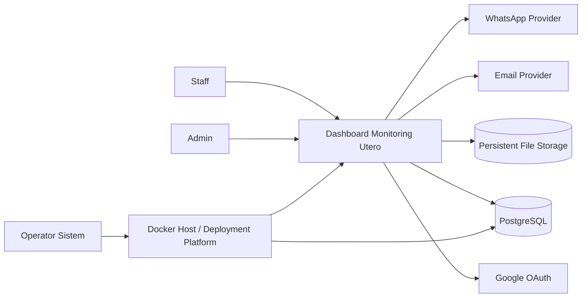
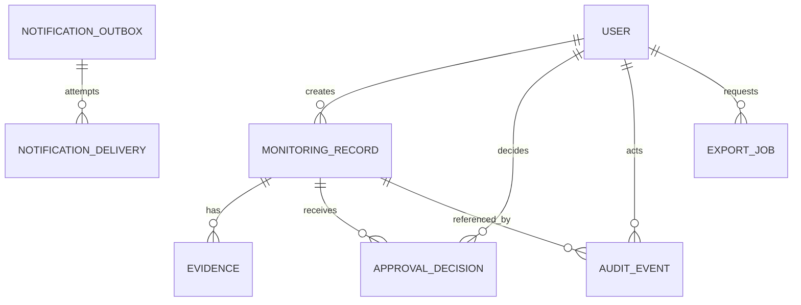
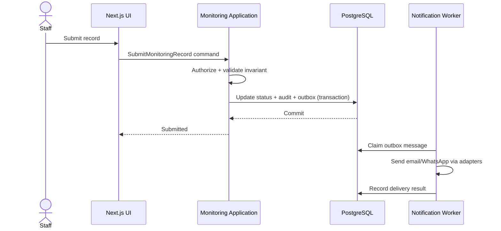

# Software System Design (SSD) - Dashboard Monitoring Utero

## 1. Status Dokumen

| Atribut | Nilai |
|---|---|
| Sistem | Dashboard Monitoring Utero |
| Arsitektur | Next.js modular monolith |
| Status | Proposed |
| Versi | 1.0 |
| Timezone bisnis | `Asia/Jakarta` |
| Dokumen keputusan | `docs/ADR.md` |

## 2. Tujuan dan Ruang Lingkup

Dashboard Monitoring Utero adalah aplikasi multi-user untuk mencatat, memantau, memverifikasi, dan menyetujui aktivitas operasional. Sistem menyediakan:

- Peran `Admin` dan `Staff` dengan hak akses berbeda.
- Pencatatan data monitoring dan unggahan bukti (evidence).
- Alur pengajuan, revisi, persetujuan, dan penolakan.
- Audit trail untuk tindakan penting.
- Ekspor Excel dan PDF.
- Notifikasi email dan WhatsApp.
- Antarmuka responsif dengan mode terang dan gelap.
- Autentikasi credentials dan tombol akun demo di development, serta Google OAuth di production.

Di luar ruang lingkup versi awal:

- Microservices dan deployment multi-region.
- Penyuntingan dokumen secara kolaboratif real-time.
- Business intelligence/data warehouse terpisah.
- Aplikasi mobile native.

## 3. Pemangku Kepentingan dan Peran

| Peran | Tanggung jawab dan akses utama |
|---|---|
| Staff | Membuat dan mengubah draft milik sendiri, mengunggah evidence, mengajukan data, melihat status dan riwayat yang diizinkan. |
| Admin | Melihat seluruh data dalam lingkup organisasi, memverifikasi, menyetujui, menolak, meminta revisi, mengelola pengguna, mengekspor laporan, dan melihat audit. |
| Operator sistem | Menjalankan deployment, backup, restore, monitoring, dan respons insiden; tidak otomatis memiliki akses data aplikasi. |

Prinsip otorisasi: default deny, least privilege, pemeriksaan akses di server untuk setiap use case, dan tidak mempercayai kontrol UI sebagai pengaman.

## 4. Kebutuhan Fungsional

### 4.1 Autentikasi dan Pengguna

- Development menyediakan login credentials lokal dan tombol login demo untuk Admin/Staff.
- Akun demo hanya aktif bila `NODE_ENV !== "production"` dan flag eksplisit diaktifkan.
- Production hanya menerima Google OAuth dengan daftar domain/email yang diizinkan.
- Pengguna baru hasil OAuth tidak otomatis mendapat hak Admin; role ditetapkan melalui provisioning atau Admin yang berwenang.
- Session dapat dicabut, memiliki absolute expiry, dan diperbarui secara aman.
- Perubahan role, aktivasi, dan deaktivasi pengguna wajib diaudit.

### 4.2 Monitoring dan Evidence

- Staff dapat membuat draft, menyunting draft milik sendiri, dan mengirimkannya untuk persetujuan.
- Record memiliki status minimal: `DRAFT`, `SUBMITTED`, `REVISION_REQUESTED`, `APPROVED`, `REJECTED`.
- Evidence mendukung metadata nama file, tipe MIME, ukuran, checksum, uploader, dan waktu unggah.
- File tidak disimpan sebagai byte di tabel transaksi utama. Metadata disimpan di PostgreSQL; objek disimpan melalui `FileStoragePort`.
- Implementasi awal dapat memakai volume lokal persisten. Port yang sama memungkinkan migrasi ke object storage tanpa mengubah domain.
- Penghapusan record/evidence menggunakan kebijakan soft delete atau retensi terkontrol; penghapusan permanen hanya melalui prosedur operator.

### 4.3 Persetujuan

- Hanya record `SUBMITTED` yang dapat disetujui, ditolak, atau diminta revisi.
- Pembuat record tidak boleh menyetujui record sendiri bila kebijakan four-eyes diaktifkan.
- Keputusan menyimpan approver, timestamp, alasan/catatan, dan versi record.
- Update memakai optimistic concurrency agar dua keputusan bersamaan tidak saling menimpa.
- Transisi status dan audit event ditulis dalam satu transaksi database.

### 4.4 Laporan dan Ekspor

- Filter laporan mencakup rentang tanggal, status, pembuat, dan atribut bisnis yang relevan.
- Excel digunakan untuk data tabular yang dapat diolah lebih lanjut.
- PDF digunakan untuk laporan berformat tetap, siap cetak, dengan metadata waktu dan pembuat ekspor.
- Ekspor besar diproses sebagai job asinkron; ekspor kecil boleh di-stream langsung.
- Setiap ekspor mematuhi otorisasi dan dicatat dalam audit trail.

### 4.5 Notifikasi

- Email dan WhatsApp dikirim untuk kejadian penting, misalnya pengajuan, permintaan revisi, persetujuan, dan penolakan.
- Pengiriman tidak berada dalam transaksi request utama.
- Domain membuat notification intent/outbox; worker mengirim melalui adapter provider.
- Retry memakai exponential backoff, batas percobaan, idempotency key, dan dead-letter state.
- Isi pesan tidak memuat evidence atau data sensitif berlebih; tautan mengarah ke aplikasi dan tetap memerlukan autentikasi.

## 5. Kebutuhan Nonfungsional

| Area | Target awal |
|---|---|
| Availability | Satu instance dapat diterima untuk deployment awal; recovery terdokumentasi. |
| Performance | p95 request interaktif server < 500 ms di luar latency provider eksternal, dengan dataset dan beban normal yang disepakati. |
| Scalability | Web stateless; dapat direplikasi setelah session, file, dan job memakai layanan bersama. |
| Accessibility | Navigasi keyboard, focus state terlihat, label form, kontras WCAG AA, dan reduced-motion. |
| Responsiveness | Mendukung mobile mulai 360 px, tablet, dan desktop; tabel besar memiliki pola scroll/card yang dapat dipakai. |
| Theme | Light/dark mengikuti pilihan pengguna atau sistem, tanpa flash tema saat load. |
| Data integrity | Constraint database, transaksi, foreign key, unique key, dan optimistic concurrency. |
| Maintainability | Batas modul eksplisit dan dependency domain tidak mengarah ke framework/infrastruktur. |
| Time | Penyimpanan timestamp dalam UTC; input, tampilan, jadwal bisnis, Excel, PDF, email, dan WhatsApp memakai `Asia/Jakarta`. |

Target harus dikalibrasi setelah baseline load test dan volume data nyata tersedia.

## 6. Konteks Sistem



Google OAuth, email, dan WhatsApp diperlakukan sebagai sistem eksternal yang dapat gagal. Adapter wajib memiliki timeout, retry terkontrol, circuit breaking bila diperlukan, dan observability.

## 7. Arsitektur Aplikasi

### 7.1 Pilihan

Dipilih modular monolith Next.js karena tim dapat mengembangkan dan mengoperasikan satu unit deploy sambil menjaga batas domain. Alternatif microservices memberi deployment dan scaling independen, tetapi menambah distributed transactions, observability lintas layanan, kontrak jaringan, dan beban operasi yang belum dibutuhkan.

### 7.2 Batas Modul

| Modul | Tanggung jawab | Data yang dimiliki |
|---|---|---|
| Identity & Access | User, role, session, OAuth provisioning, policy akses | users, accounts, sessions, role assignments |
| Monitoring | Record monitoring, atribut bisnis, pencarian, status lifecycle | monitoring records dan detail |
| Evidence | Validasi upload, metadata, akses file, retensi | evidence metadata |
| Approval | Transisi approval, komentar keputusan, segregation of duties | approval decisions/history |
| Reporting | Query laporan, Excel/PDF generation | export jobs dan artefak ekspor |
| Notification | Template, preference, outbox, delivery attempts | notification outbox/delivery |
| Audit | Append-only security/business audit | audit events |
| Administration | Pengelolaan pengguna, konfigurasi referensi, health operasional terbatas | admin configuration |

Modul tidak mengakses tabel modul lain secara langsung dari application service. Kolaborasi terjadi melalui public application API, domain event in-process, atau read model yang didokumentasikan. Database tetap satu PostgreSQL, tetapi ownership tabel dan migrasi harus jelas.

### 7.3 Lapisan dan Dependency

```text
UI / Route Handlers / Server Actions
                |
                v
       Application Use Cases
          |             |
          v             v
       Domain       Port Interfaces
                         |
                         v
        Infrastructure Adapters
  (PostgreSQL, file, OAuth, email, WhatsApp)
```

- Domain berisi policy, invariant, entity/value object, dan domain event; tidak mengimpor Next.js, ORM, database, provider, atau transport.
- Application mengatur use case, transaksi, authorization policy, dan port.
- Adapter delivery menerjemahkan HTTP/form/session ke command/query dan tidak memanggil repository langsung.
- Infrastructure mengimplementasikan repository dan integrasi eksternal.
- Validasi bentuk input dilakukan di boundary; invariant bisnis tetap dijaga domain/application.

### 7.4 Struktur Kode Rekomendasi

```text
src/
  app/                         # Next.js routes dan layouts
  modules/
    monitoring/
      domain/
      application/
      infrastructure/
      presentation/
      index.ts                 # public API modul
    approval/
    evidence/
    reporting/
    notification/
    audit/
    identity/
  shared/
    domain/                    # primitive lintas modul yang benar-benar stabil
    infrastructure/
```

`shared` dijaga kecil agar tidak menjadi tempat sampah coupling lintas modul.

## 8. Model Domain dan Data

### 8.1 Aggregate Utama

- `MonitoringRecord`: menjaga lifecycle, ownership, kelengkapan data, dan aturan kapan record dapat diajukan.
- `ApprovalCase`: menjaga keputusan yang valid terhadap versi record dan aturan approver.
- `Evidence`: menjaga metadata, ownership, status scan, dan hubungan ke record.
- `User`: menjaga status akun dan role assignment; detail session tetap concern identity.

Batas transaksi mengikuti aggregate. Operasi lintas aggregate memakai application service dan transaksi database bila benar-benar membutuhkan konsistensi kuat.

### 8.2 Entitas Konseptual



Kolom umum:

- Primary key UUID/ULID yang dibuat aplikasi.
- `created_at`, `updated_at` sebagai `timestamptz` UTC.
- `version` integer untuk optimistic concurrency pada aggregate yang sering berubah.
- `created_by`/`updated_by` bila relevan.
- Constraint status dan foreign key di database, tidak hanya di kode.
- Audit event memakai payload terstruktur dan redaction; bukan salinan bebas seluruh row.

### 8.3 Strategi Waktu

- Database dan komunikasi internal memakai UTC.
- Zona bisnis tunggal adalah `Asia/Jakarta` (WIB, UTC+7).
- Konversi dilakukan di boundary presentasi/reporting memakai library timezone-aware.
- Tanggal tanpa waktu diperlakukan sebagai business date, bukan timestamp UTC tersembunyi.
- Container menetapkan `TZ=Asia/Jakarta` untuk konsistensi job, tetapi kode tidak bergantung pada timezone OS.

## 9. Alur Kritis

### 9.1 Pengajuan dan Persetujuan



### 9.2 Upload Evidence

1. Server memeriksa session, ownership, status record, ukuran, extension, dan MIME yang terdeteksi dari konten.
2. File diberi nama internal acak; nama asli hanya metadata ter-sanitasi.
3. File ditempatkan di area quarantine, checksum dihitung, lalu dipindai malware bila scanner tersedia.
4. Metadata dan lokasi final disimpan setelah validasi berhasil.
5. Download melewati authorization check dan memakai `Content-Disposition: attachment` untuk tipe berisiko.

Jika antivirus belum tersedia pada fase awal, tipe file dibatasi ketat dan status risiko dicatat sebagai utang keamanan sebelum akses publik lebih luas.

## 10. API dan Kontrak Internal

- Gunakan Server Actions untuk mutasi yang erat dengan UI dan Route Handlers untuk download, webhook, health, atau endpoint integrasi.
- Semua mutasi memakai schema validation, authorization, CSRF defense sesuai mekanisme auth, dan idempotency bila request dapat diulang.
- Error eksternal tidak membocorkan stack trace, query, path storage, token, atau data pengguna lain.
- Error domain memakai kode stabil, misalnya `RECORD_NOT_SUBMITTABLE`, bukan parsing pesan teks.
- Pagination wajib untuk daftar; cursor pagination dipilih untuk data besar/sering berubah, offset cukup untuk tabel admin kecil.
- Webhook provider memvalidasi signature, timestamp, replay window, dan idempotency key.

## 11. Security

### 11.1 Authentication dan Session

- Google OAuth memakai Authorization Code flow melalui library terpelihara; validasi `state`, `nonce`, issuer, audience, dan redirect URI.
- Cookie session `HttpOnly`, `Secure` di production, dan `SameSite=Lax` atau lebih ketat bila alur OAuth mengizinkan.
- Credentials development menggunakan password hash kuat; password/demo secret tidak ditanam dalam source atau image.
- Endpoint demo tidak dibangun/diaktifkan di production. Startup production gagal bila flag demo aktif.
- Rate limiting diterapkan pada login, upload, ekspor, dan endpoint mahal.

### 11.2 Authorization

- RBAC `Admin`/`Staff` ditambah pemeriksaan ownership dan state record.
- Policy dijalankan dalam application use case, bukan hanya middleware route.
- Query list dan export menerapkan filter scope di server agar tidak terjadi insecure direct object reference.
- Tindakan sensitif dapat membutuhkan recent authentication.

### 11.3 Perlindungan Data

- TLS wajib di production; PostgreSQL tidak diekspos publik.
- Secret disediakan melalui secret manager atau environment runtime, tidak masuk Git, log, export, atau client bundle.
- Encryption at rest mengikuti volume/database platform; backup juga terenkripsi.
- Query terparameterisasi melalui driver/ORM; output HTML memakai escaping default dan sanitasi untuk rich text bila ada.
- Header keamanan minimal: CSP, HSTS, `X-Content-Type-Options`, `Referrer-Policy`, dan frame protection.
- Dependency scanning, image scanning, dan patch cadence menjadi bagian pipeline.

### 11.4 Upload Security

- Allowlist tipe dan ukuran; tolak executable, macro-enabled document bila tidak dibutuhkan, archive berisiko, dan polyglot yang terdeteksi.
- File disimpan di luar public web root dan tidak dieksekusi.
- Nama storage acak, path tidak berasal dari input pengguna, dan checksum mendukung integrity/deduplication.
- Download diautorisasi per objek dan dicatat untuk evidence sensitif.
- Retensi, quarantine, malware scan, dan prosedur penghapusan terdokumentasi.

### 11.5 Audit

- Audit event append-only secara logis dan hanya dapat dibaca role berwenang.
- Catat actor, action, target type/id, hasil, waktu, request/correlation ID, source IP terproteksi, user agent ringkas, dan perubahan field yang aman.
- Jangan catat password, token, cookie, isi file, atau secret provider.
- Perubahan/penghapusan audit dibatasi operator dan menghasilkan alert; opsi hash chaining dapat ditambahkan bila kebutuhan tamper evidence meningkat.

## 12. Observability dan Operasi

### 12.1 Structured Logging

- JSON log dengan timestamp UTC, level, service/version, environment, request ID, user ID pseudonymous bila perlu, module, event name, duration, dan result.
- Redaction otomatis untuk authorization header, cookie, token, password, PII sensitif, dan payload file.
- Request ID diteruskan ke job/outbox agar alur dapat ditelusuri.

### 12.2 Metrics

- HTTP request rate, error rate, dan latency per route group.
- Database connection usage, query latency, deadlock, dan migration status.
- Upload count/size/failure, storage capacity, dan malware scan result.
- Approval queue age dan jumlah record per status.
- Outbox backlog, notification success/failure/retry, dan export job duration.
- Login failure, denied authorization, rate-limit hit, dan anomali security lain.

### 12.3 Tracing dan Alerting

- OpenTelemetry direkomendasikan untuk trace web, query penting, job, dan provider eksternal.
- Alert berbasis dampak: error rate tinggi, latency buruk, database hampir penuh, backup gagal, outbox tertahan, storage hampir penuh, dan login attack pattern.
- Health endpoint dipisah: liveness tidak bergantung provider eksternal; readiness memeriksa dependency wajib seperti database.
- Runbook mencakup database unavailable, provider gagal, disk penuh, job macet, dan OAuth outage.

## 13. Backup dan Disaster Recovery

- PostgreSQL: backup harian terenkripsi ditambah WAL archiving/PITR bila platform mendukung.
- Evidence storage: snapshot/versioned backup terpisah dan konsisten dengan metadata database.
- Konfigurasi deployment, migration, dan template pesan disimpan dalam version control; secret dicadangkan melalui mekanisme secret manager.
- Backup disimpan di lokasi/storage failure domain berbeda dari server utama.
- Retensi awal: 7 backup harian, 4 mingguan, dan 12 bulanan; finalisasi mengikuti regulasi dan kapasitas.
- Target awal: RPO 24 jam tanpa PITR atau <= 15 menit dengan PITR; RTO 4 jam. Bisnis harus menyetujui target final.
- Restore drill minimal triwulanan ke environment terisolasi, termasuk verifikasi jumlah record, referensi evidence, checksum sampel, dan kemampuan login.
- Backup dianggap valid hanya setelah restore berhasil diuji dan hasilnya dicatat.

## 14. Deployment

### 14.1 Lokal dengan Docker Compose

| Service | Container port | Host port |
|---|---:|---:|
| Next.js app | 3000 | 3010 |
| PostgreSQL | 5432 | 5433 |

Koneksi antar-container memakai nama service dan port container, misalnya `postgres:5432`; `localhost:5433` hanya untuk akses host. Volume persisten digunakan untuk database dan file evidence lokal. Container memakai non-root user, health check, resource limit, dan restart policy yang sesuai.

### 14.2 Production

- Build image multi-stage, immutable, minimal, dan memiliki SBOM/image scan.
- Database dikelola mandiri/dedicated PostgreSQL; hanya dapat diakses jaringan privat dari aplikasi/worker dan jalur administrasi terbatas.
- Reverse proxy/load balancer menangani TLS dan meneruskan trusted proxy headers secara terkontrol.
- Migration dijalankan sebagai release step tunggal sebelum traffic versi baru, bukan serentak oleh setiap replica.
- Gunakan expand-migrate-contract untuk perubahan schema agar rollback aplikasi tetap mungkin.
- Deployment awal dapat berupa satu app container dan satu worker container dari image yang sama. Scaling horizontal dilakukan setelah file storage dan job coordination tidak bergantung disk lokal app.
- Rollback memakai image sebelumnya; migration destruktif ditunda sampai versi lama tidak lagi dibutuhkan.

### 14.3 Konfigurasi Minimum

```text
NODE_ENV
TZ=Asia/Jakarta
DATABASE_URL
AUTH_SECRET
AUTH_GOOGLE_ID
AUTH_GOOGLE_SECRET
GOOGLE_ALLOWED_DOMAIN_OR_EMAILS
AUTH_MODE
AUTH_DEMO_ENABLED
FILE_STORAGE_DRIVER
FILE_STORAGE_PATH
EMAIL_PROVIDER_*
WHATSAPP_PROVIDER_*
OTEL_EXPORTER_*
```

Startup production wajib menolak konfigurasi lemah: demo auth aktif, secret default, callback OAuth non-HTTPS, atau storage ephemeral untuk evidence.

## 15. Testing dan Quality Gates

### 15.1 Test Pyramid

- Unit test: domain transitions, invariant, policy ownership, timezone conversion, dan template mapping.
- Integration test: repository terhadap PostgreSQL nyata via container, transaction/outbox, migration, file adapter, dan provider adapter dengan fake server.
- Contract test: payload email/WhatsApp provider, webhook, OAuth claims, dan format ekspor.
- E2E test: login dev, OAuth callback terkontrol, Staff membuat-upload-submit, Admin approve/reject/revision, export, dan authorization denial.
- Security test: horizontal/vertical privilege escalation, CSRF, upload bypass, path traversal, XSS, SQL injection, session fixation, rate limiting, dan secret leakage.
- Visual/accessibility test: mobile/desktop, light/dark, keyboard, screen reader semantics, focus, contrast, dan PDF snapshot.
- Performance test: list/filter, upload maksimum, concurrent approval, export besar, dan backlog worker.
- Recovery test: restore database/evidence dan rollback release.

### 15.2 Pipeline Minimum

1. Install dependency dengan lockfile.
2. Lint, type-check, unit test, dan secret scan.
3. Integration test dengan PostgreSQL container.
4. Build production image dan jalankan migration dry-run/test.
5. Dependency/SAST/image scan.
6. E2E smoke test pada environment sementara.
7. Deploy dengan approval sesuai environment, lalu smoke test dan verifikasi metrics.

Perubahan tidak boleh dirilis bila migration gagal, test authorization kritis gagal, vulnerability kritis belum diterima secara formal, atau restore path tidak terdokumentasi.

## 16. Risiko dan Mitigasi

| Risiko | Dampak | Mitigasi |
|---|---|---|
| Modular monolith berubah menjadi tightly coupled monolith | Perubahan lintas modul sulit | Public API modul, ownership tabel, dependency linting, architecture test. |
| File lokal hilang saat redeploy | Evidence hilang | Volume persisten, backup, checksum, dan migrasi ke object storage sebelum horizontal scaling. |
| Provider email/WhatsApp lambat/gagal | Request lambat atau notifikasi hilang | Transactional outbox, worker, retry, DLQ, metrics. |
| Demo auth bocor ke production | Pengambilalihan akun | Build/runtime guard, production config test, endpoint absent/disabled. |
| Approval ganda/race condition | Keputusan tidak konsisten | Transaction, row/version check, unique constraint, idempotency. |
| Export membocorkan data | Insiden privasi | Server-side scope filter, audit, expiry artefak, signed/authorized download. |
| Audit menyimpan secret/PII | Eksposur data | Structured schema, allowlist field, redaction, retention policy. |
| PostgreSQL mandiri menjadi single point of failure | Downtime/data loss | Backup teruji, monitoring, PITR, runbook; tambah replica/failover saat SLO menuntut. |

## 17. Evolusi Arsitektur

1. Mulai dengan satu deployable Next.js, PostgreSQL, worker, dan persistent storage.
2. Ukur bottleneck nyata melalui metrics dan tracing.
3. Pindahkan evidence ke object storage ketika butuh replica aplikasi atau kapasitas lebih besar.
4. Pisahkan worker secara independen ketika notification/export membebani request path.
5. Pertimbangkan read replica/materialized view untuk reporting bila query mengganggu transaksi.
6. Ekstrak service hanya bila ada kebutuhan deployment, scaling, reliability, atau ownership tim yang independen; pertahankan kontrak modul sebagai seam ekstraksi.

## 18. Kriteria Penerimaan Arsitektur

- Semua use case sensitif memiliki server-side authorization test.
- Demo auth tidak dapat aktif di production.
- Pengajuan, keputusan approval, audit, dan outbox konsisten secara transaksional.
- Evidence tidak dapat diakses tanpa authorization dan tidak berada di public web root.
- Docker lokal mengekspos app di `localhost:3010` dan PostgreSQL di `localhost:5433`.
- Waktu tampil/report konsisten dalam `Asia/Jakarta`, sedangkan timestamp tersimpan UTC.
- Backup database dan evidence dapat direstore melalui drill yang tercatat.
- Dashboard usable pada mobile/desktop serta light/dark.
- Metrics, logs, health checks, dan alert kritis tersedia sebelum production go-live.


