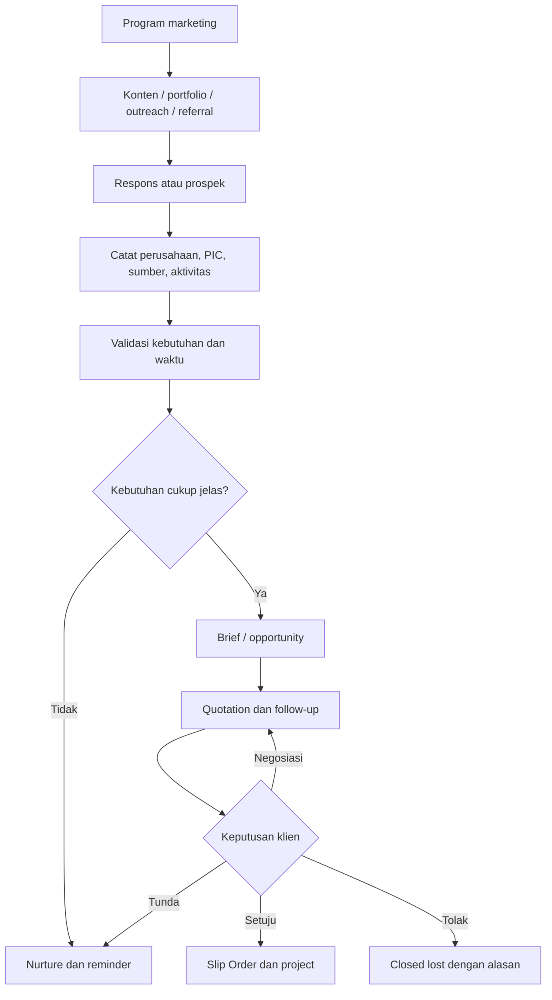
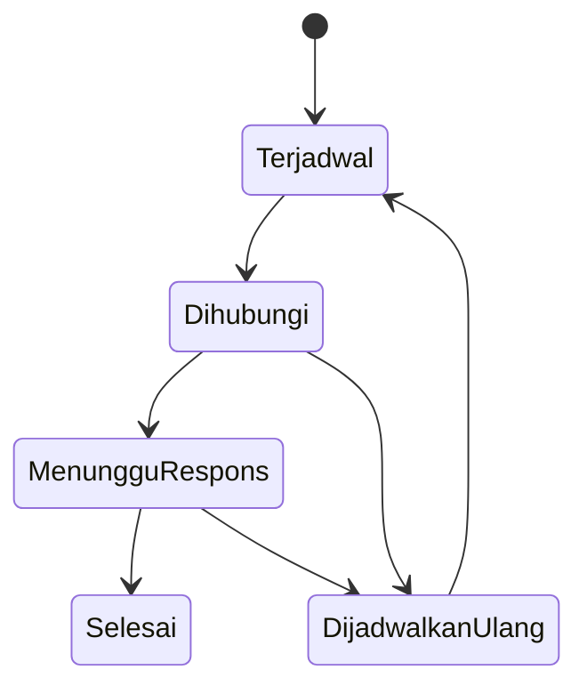
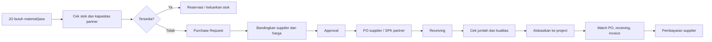
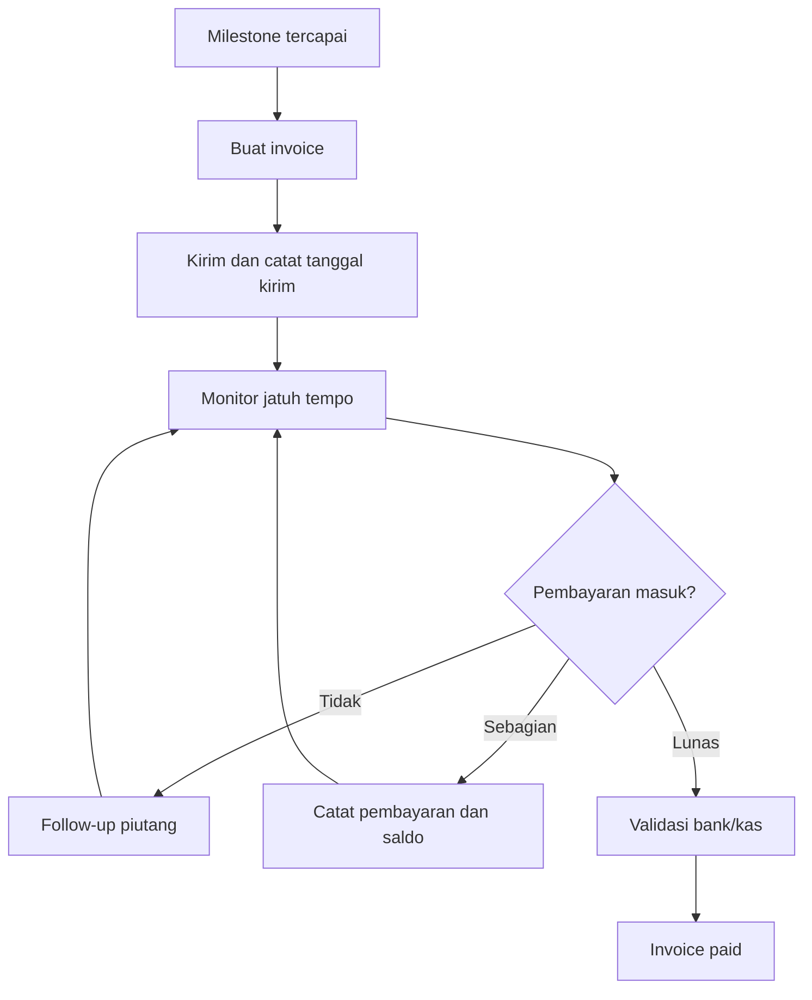

# Dokumentasi Terpadu ERP dan Operasional Utero Indonesia

Dokumen ini menggabungkan:

- [`file-01.md`](file-01.md): kebutuhan administrasi ERP berdasarkan siklus pekerjaan.
- [`file-02.md`](file-02.md): alur operasional, relasi data, status, peran, dan penomoran dokumen.
- [`file-03.md`](file-03.md): marketing, akuisisi klien baru, reminder, dan pengembangan klien lama.

File sumber tetap dipertahankan. Dokumen ini menjadi acuan konseptual untuk penerapan modul ERP ke dashboard monitoring.

## 1. Tujuan dan Ruang Lingkup

ERP Utero menyatukan aktivitas komersial, operasional, produksi, purchasing, pengiriman, keuangan, dan hubungan pelanggan dalam satu alur yang dapat ditelusuri.

Tujuan utama:

1. Menjaga riwayat perusahaan, PIC, peluang, proyek, dokumen, komunikasi, biaya, dan pembayaran tetap terhubung.
2. Memastikan setiap pekerjaan punya pemilik, status, tenggat, dokumen pendukung, dan jejak persetujuan.
3. Memisahkan kondisi pekerjaan dari kondisi pembayaran.
4. Mengubah peluang marketing menjadi order tanpa input ulang data pelanggan.
5. Menyediakan dashboard untuk tindakan harian, bukan hanya laporan historis.

Siklus utama:

```mermaid
flowchart LR
    A[Marketing dan prospek] --> B[Brief dan validasi]
    B --> C[RAB / BOQ / quotation]
    C --> D[Negosiasi dan approval]
    D --> E[PO / kontrak / Slip Order]
    E --> F[Job Order dan readiness gate]
    F --> G[Desain / produksi / layanan]
    G --> H[QC dan rework]
    H --> I[Pengiriman / pemasangan]
    I --> J[BAST]
    J --> K[Invoice dan pembayaran]
    K --> L[Evaluasi, garansi, repeat order]
    L --> A
```



## 2. Prinsip Sistem

### 2.1 Satu nomor proyek sebagai tulang punggung

Setelah peluang berubah menjadi pekerjaan, sistem membuat satu nomor proyek, misalnya `PRJ-2026-001`. Nomor ini menghubungkan seluruh dokumen dan aktivitas:

```text
Customer / prospek
  |- Opportunity / brief
      |- Quotation / RAB / BOQ
          |- PO / kontrak / Slip Order
              |- Job Order / SPK / produksi
                  |- Purchasing / stok / supplier
                      |- QC / pengiriman / BAST
                          |- Invoice / pembayaran / biaya proyek
                              |- Reminder / garansi / repeat order
```

Nomor proyek tidak berubah ketika status pekerjaan berubah. Setiap dokumen punya nomor sendiri, tetapi seluruhnya menyimpan `project_id` yang sama.

### 2.2 Identitas perusahaan tetap tunggal

Satu perusahaan dapat memiliki banyak PIC, peluang, order, cabang, dan histori komunikasi. Sistem menghubungkan perusahaan dengan kontak, alamat, quotation, proyek, kontrak, reminder, komplain, garansi, dan repeat order.

### 2.3 Status dipisahkan

Status pekerjaan dan status pembayaran tidak boleh digabung. Proyek dapat selesai dan sudah diserahterimakan, tetapi invoice masih belum lunas. Sebaliknya, uang muka dapat diterima sebelum pekerjaan dimulai.

### 2.4 Semua tindakan dapat diaudit

Setiap dokumen/aktivitas minimal memiliki:

| Field | Fungsi |
|---|---|
| `customer_id` | Identitas perusahaan pelanggan/prospek |
| `project_id` | Penghubung seluruh data pekerjaan |
| Nomor dokumen | Identitas quotation, order, JO, invoice, dan lainnya |
| Tanggal | Tanggal dibuat, berlaku, jatuh tempo, atau selesai |
| PIC | Penanggung jawab |
| Status | Posisi data dalam alur |
| Lampiran | Brief, desain, PO, BAST, bukti bayar, dan dokumen lain |
| Persetujuan | Approver dan waktu persetujuan |
| Riwayat perubahan | Perubahan nilai, lingkup, status, atau spesifikasi |

## 3. Model Data dan Relasi

| Entitas | Isi utama | Relasi |
|---|---|---|
| Perusahaan | Identitas, alamat, klasifikasi, sumber | Memiliki PIC, peluang, proyek |
| PIC/kontak | Nama, jabatan, telepon, email | Milik perusahaan, menjadi penghubung aktivitas |
| Program marketing | Kampanye, channel, target, periode, PIC | Menghasilkan prospek dan aktivitas |
| Opportunity | Kebutuhan, potensi, prioritas, nilai, tahap | Terhubung ke perusahaan dan brief |
| Brief | Lingkup, spesifikasi, lokasi, jumlah, deadline | Dasar kalkulasi dan quotation |
| Quotation | Item, harga, termin, masa berlaku, revisi | Menghasilkan order jika disetujui |
| Project | Nomor, tipe layanan, PIC, status | Pusat dokumen operasional |
| Slip Order | Order internal yang diterima | Input Job Order |
| Job Order | Penugasan, output, timeline, tim | Menghasilkan pekerjaan/purchasing |
| Purchase Request | Kebutuhan material/jasa | Dapat menghasilkan PO supplier |
| Supplier/partner | Vendor, layanan, legalitas, rekening | Terhubung PR, PO, receiving, invoice |
| Stock item | Bahan, jumlah, satuan, lokasi, minimum | Dipakai atau dipesan untuk proyek |
| Production order | Spesifikasi, BOM, kuantitas, target | Terhubung material, QC, rework |
| Delivery/BAST | Pengiriman, pemasangan, penerimaan | Menutup serah terima |
| Invoice/payment | Tagihan, termin, uang masuk, saldo | Terhubung project dan customer |
| Reminder | Pemicu, tanggal, tindakan, PIC, status | Terhubung customer/project/kontrak/invoice |
| Activity log | Panggilan, email, kunjungan, hasil | Histori CRM dan audit |

### Penomoran dokumen

| Dokumen | Contoh |
|---|---|
| Project | `PRJ-2026-001` |
| Quotation | `QTN-2026-001` |
| Sales Order / Slip Order | `SO-2026-001` |
| Job Order | `JO-2026-001` |
| Production Order | `PROD-2026-001` |
| Purchase Request | `PR-2026-001` |
| Purchase Order | `PO-2026-001` |
| Surat Jalan | `SJ-2026-001` |
| BAST | `BAST-2026-001` |
| Invoice | `INV-2026-001` |
| Payment | `PAY-2026-001` |

PO pelanggan dan PO pembelian wajib dibedakan. Invoice adalah tagihan; kuitansi/bukti penerimaan adalah bukti pembayaran.

## 4. Marketing, CRM, dan Akuisisi Klien

### Alur klien baru



Channel minimal: Instagram, website, WhatsApp, referral, kunjungan, dan direct outreach. Setiap prospek menyimpan sumber, kebutuhan, PIC, prioritas, nilai estimasi, next action, dan tanggal follow-up.

| Prioritas | Definisi | Tindakan |
|---|---|---|
| A | Kebutuhan aktif dan waktu dekat | Hubungi cepat, discovery, quotation |
| B | Kebutuhan masa depan dengan sinyal | Nurture dan reminder |
| C | Akses awal atau belum terverifikasi | Validasi PIC dan kebutuhan |
| D | Tidak sesuai target | Simpan alasan, hentikan aktivitas aktif |

Perkiraan potensi wajib memiliki dasar, misalnya pembukaan cabang, kalender event, permintaan katalog, atau histori kebutuhan. Data belum terkonfirmasi diberi label estimasi internal.

### Reminder dan pengembangan akun

Reminder marketing, penagihan, dan garansi memiliki kategori berbeda walaupun tampil dalam satu profil pelanggan.



Jenis reminder:

- pemeriksaan hasil pekerjaan: 3-7 hari setelah serah terima;
- evaluasi layanan: sekitar 14 hari;
- repeat order sesuai siklus pemakaian;
- pembaruan menu, katalog, dan materi promosi;
- akhir sewa media: 30 dan 14 hari sebelum berakhir;
- kontrak vendor/retainer: 60 dan 30 hari sebelum berakhir;
- kampanye musiman: 6-8 minggu sebelum agenda;
- pembukaan cabang, perawatan signage, dan klien tidak aktif sekitar 90 hari;
- penawaran tertunda sesuai waktu keputusan klien.

Setiap reminder memiliki alasan, PIC, tindakan berikutnya, tanggal, hasil, dan alasan penjadwalan ulang.

## 5. Penjualan, Brief, dan Quotation

1. Admin/sales membuat atau memilih perusahaan dan PIC.
2. Sistem membuat opportunity dan brief.
3. Tim memvalidasi kebutuhan teknis, kuantitas, lokasi, deadline, file, dan batasan.
4. Tim menyusun RAB, BOQ, harga jual, margin, termin, dan jadwal.
5. Manager melakukan review dan approval internal.
6. Quotation dikirim ke klien.
7. Setiap revisi menyimpan versi, perubahan lingkup, harga, waktu, dan approver.
8. Keputusan klien dicatat sebagai negosiasi, ditunda, ditolak, atau diterima.
9. Jika diterima, opportunity dikonversi menjadi project tanpa menyalin ulang identitas perusahaan.

RAB adalah kalkulasi internal. BOQ merinci item, satuan, volume, spesifikasi, dan harga. Quotation adalah dokumen eksternal.

## 6. Order Intake dan Readiness Gate

Dasar order dapat berupa PO pelanggan, kontrak, SPK pelanggan, atau konfirmasi tertulis sesuai kebijakan perusahaan. Setelah diterima, sistem membuat Slip Order sebagai penghubung penjualan dan operasional.

Checklist sebelum mulai kerja:

- brief dan lingkup final tersedia;
- harga dan margin disetujui;
- spesifikasi, file, ukuran, jumlah, lokasi, dan deadline jelas;
- PO/kontrak/SPK tersedia atau dasar kerja alternatif disetujui;
- termin pembayaran dan syarat uang muka jelas;
- kapasitas tim, vendor, material, dan jadwal tersedia;
- risiko, perubahan lingkup, dan asumsi terdokumentasi.

Status `Siap Dikerjakan` hanya aktif jika syarat mulai kerja lengkap, misalnya uang muka diterima, PO tersedia, atau fasilitas termin disetujui.

## 7. Job Order dan Pelaksanaan Layanan

Job Order menerjemahkan Slip Order menjadi tugas internal. Isi minimal: tujuan, output, scope, project number, PIC, tim, deadline, dependensi, file, estimasi biaya, dan kriteria selesai.

| Jenis layanan | Alur |
|---|---|
| Branding/desain | Brief > riset > konsep > presentasi > revisi > approval > file final |
| Produksi fisik | Spesifikasi > BOM > cek material > produksi > finishing > QC |
| Video/audio | Brief > script > pre-production > shooting/recording > editing > review > final |
| Advertising/media | Kebutuhan > media plan > materi > approval > placement > monitoring > report |
| Event | Brief > konsep > vendor/logistik > produksi > pelaksanaan > breakdown > evaluasi |
| Website/teknologi | Requirement > scope > desain > development > QA/UAT > deployment > maintenance |

Persetujuan artwork menyimpan versi file, tanggal, approver, dan catatan. Perubahan setelah approval masuk sebagai change order bila memengaruhi biaya atau waktu.

## 8. Purchasing, Supplier, Partner, dan Stok



Alur menyimpan alasan pemilihan vendor, harga, lead time, kualitas, dan keterkaitan biaya dengan project. Gudang membedakan stok tersedia, dipesan, dicadangkan, dipakai, rusak, dan sisa.

## 9. Produksi, QC, dan Rework

Production Order mencatat spesifikasi, kuantitas, BOM, material, target selesai, dan penanggung jawab. QC mencatat checklist, hasil inspeksi, bukti foto bila perlu, dan keputusan.

Hasil QC: lulus dan lanjut; lulus dengan catatan; tidak lulus dan masuk rework; atau ditolak/dibuat ulang dengan approval.

Rework wajib memiliki penyebab, penanggung jawab, dampak biaya/waktu, deadline baru, dan hasil pemeriksaan ulang.

## 10. Pengiriman, Pemasangan, BAST, Komplain, Garansi

1. Admin/operasional membuat Surat Jalan dengan alamat, item, jumlah, pengirim, penerima, dan project number.
2. Tim melakukan pengiriman atau pemasangan.
3. Penerima memeriksa hasil dan menandatangani BAST.
4. Kekurangan, kerusakan, atau pekerjaan tersisa menjadi task tindak lanjut.
5. Sistem membuat reminder pemeriksaan hasil, evaluasi layanan, atau jadwal garansi.
6. Komplain dicatat sebagai case terpisah, tetap terhubung ke project dan BAST.

BAST adalah bukti serah terima, bukan bukti pembayaran. Invoice mengikuti termin yang disepakati.

## 11. Invoice, Pembayaran, AR/AP, dan Biaya



Finance mengelola termin, invoice, kuitansi, bukti pembayaran, AR/AP, cash in/out, reimbursement, biaya langsung proyek, biaya vendor/material/tenaga, rekonsiliasi, pajak, dan margin proyek.

Status invoice minimal: `Draft`, `Menunggu Approval`, `Terkirim`, `Jatuh Tempo`, `Dibayar Sebagian`, `Lunas`, `Overdue`, `Void`.

## 12. State Machine Sistem

| Objek | Status |
|---|---|
| Opportunity | `New > Contacted > Qualified > Briefing > Quoted > Negotiation > Won/Lost/Postponed` |
| Project/order | `Draft > Waiting Documents > Ready to Work > In Progress > QC > Rework > Ready to Deliver > Delivered > Closed` |
| Pembayaran project | `Not Billed > Partially Billed > Partially Paid > Paid` |
| Job Order | `Draft > Approved > Assigned > In Progress > Waiting Review > Approved/Rework > Done/Cancelled` |
| Purchasing | `Requested > Reviewing > Approved > Ordered > Partially Received > Received > Allocated > Closed` |
| Reminder | `Terjadwal > Dihubungi > Menunggu Respons > Selesai/Dijadwalkan Ulang` |

Setiap perpindahan status menyimpan actor, timestamp, catatan, dan lampiran bila relevan.

## 13. Peran dan Approval

| Peran | Tanggung jawab |
|---|---|
| Sales/admin | CRM, brief, quotation, komunikasi, follow-up |
| Manager operasional | Kapasitas, Job Order, timeline, eskalasi |
| Creative/video/IT | Output layanan dan revisi teknis |
| Purchasing | Vendor, PR, PO supplier, receiving administratif |
| Produksi/gudang | Material, produksi, QC, stok, pengiriman |
| Finance | Invoice, pembayaran, AR/AP, biaya, pajak |
| Founder/approver | Harga, risiko, vendor, pengecualian, kebijakan |

Hak akses mengikuti least privilege. Perubahan harga, approval, void invoice, dan status kritis memerlukan otorisasi.

## 14. Dashboard dan Indikator

### Dashboard eksekutif

- quotation aktif dan conversion rate;
- proyek berjalan, terlambat, dan menunggu approval;
- omzet, invoice outstanding, dan overdue;
- margin estimasi versus aktual;
- biaya proyek dan komitmen purchasing;
- kapasitas tim dan beban Job Order;
- risiko dan keputusan yang tertunda.

### Dashboard operasional

- Job Order hari ini/minggu berjalan;
- pekerjaan menunggu brief, approval, atau file;
- deadline mendekat dan terlambat;
- QC gagal dan rework;
- material kurang, PR terbuka, receiving tertunda;
- pengiriman, pemasangan, dan BAST belum selesai.

### Dashboard marketing/CRM

- prospek baru;
- quotation aktif;
- reminder hari ini dan overdue;
- akun perlu follow-up;
- kontrak/sewa media mendekati akhir;
- repeat-order opportunity;
- aktivitas komunikasi belum tercatat.

Target awal: 100 pendekatan relevan/bulan, 20 percakapan berkualitas/bulan, 10 quotation/bulan, 3 klien baru/bulan, 5 review akun lama/minggu, 100% reminder ditindaklanjuti/reschedule dengan alasan, 1 konten FAQ/penawaran per minggu, dan 100% aktivitas komunikasi tercatat.

## 15. Scope Implementasi Tahap Awal

1. Master perusahaan, PIC, supplier, user, dan layanan.
2. CRM prospek, activity log, opportunity, dan reminder.
3. Brief, quotation, revisi quotation, dan approval.
4. Project, Slip Order, Job Order, timeline, dan status.
5. Purchasing, supplier, PR, PO, receiving, dan alokasi biaya.
6. Produksi, QC, rework, delivery, BAST, dan komplain.
7. Invoice, payment, AR/AP, dan ringkasan biaya proyek.
8. Dashboard per peran, attachment, penomoran, dan audit trail.

Fitur lanjutan seperti accounting, WhatsApp/email, forecasting, vendor portal, mobile approval, dan analitik margin dapat ditambahkan jika `customer_id`, `project_id`, actor, status, dan audit log konsisten.

## 16. Contoh End-to-End: Proyek Neonbox

1. Marketing mencatat perusahaan dan PIC dari referral.
2. Sales mencatat ukuran, jumlah, lokasi, deadline, dan foto lokasi.
3. Tim menyusun BOQ, RAB material, biaya produksi, pemasangan, dan margin.
4. Manager menyetujui quotation `QTN-2026-001`.
5. Klien mengirim PO; sistem membuat `PRJ-2026-001` dan `SO-2026-001`.
6. Manager menerbitkan `JO-2026-001`; desain masuk approval.
7. Artwork disetujui; sistem membuat `PROD-2026-001`.
8. Kekurangan material menghasilkan `PR-2026-001` dan `PO-2026-001`.
9. Material diterima, diperiksa, dan dialokasikan.
10. Produksi selesai; QC mencatat hasil lulus.
11. Tim membuat `SJ-2026-001`, mengirim, dan memasang.
12. Klien menandatangani `BAST-2026-001`.
13. Finance membuat `INV-2026-001`; pembayaran dicatat sebagai `PAY-2026-001`.
14. Sistem membuat reminder pemeriksaan hasil 3-7 hari kemudian dan peluang repeat order.

## 17. Aturan Operasional Penting

- Jangan membuat project baru untuk setiap revisi quotation; gunakan versi quotation pada opportunity yang sama sampai order diterima.
- Jangan menyimpan PO supplier sebagai PO pelanggan.
- Jangan menandai project lunas hanya karena sudah diserahterimakan.
- Jangan menutup project sebelum dokumen wajib, biaya, invoice, saldo, dan tindak lanjut selesai atau diberi alasan pengecualian.
- Jangan menghitung follow-up/reminder sebagai pendekatan prospek baru.
- Jangan menghapus histori; gunakan pembatalan, void, revisi, atau closed dengan alasan.
- Setiap perubahan lingkup setelah approval harus memengaruhi versi, harga, jadwal, atau change order secara eksplisit.

## 18. Kesimpulan

ERP Utero bukan kumpulan formulir terpisah. Sistem bekerja sebagai rantai data yang menghubungkan marketing, perusahaan, opportunity, quotation, project, Job Order, purchasing, produksi, delivery, invoice, payment, dan reminder.

Kunci implementasi:

1. `project_id` menjadi penghubung utama setelah order.
2. Identitas perusahaan dan PIC dipakai ulang di seluruh modul.
3. Status pekerjaan, pembayaran, dan reminder dipisahkan.
4. Approval, lampiran, perubahan, dan aktivitas komunikasi dicatat sebagai histori.
5. Dashboard menampilkan pekerjaan yang perlu dilakukan, bukan hanya angka ringkasan.

## 19. Glosarium dan Definisi Selesai

| Istilah | Definisi |
|---|---|
| Prospect/lead | Kontak atau perusahaan yang belum memiliki kebutuhan tervalidasi |
| Opportunity | Peluang komersial dengan kebutuhan, nilai, dan next action |
| Brief | Rincian kebutuhan pekerjaan yang menjadi dasar kalkulasi |
| Quotation | Penawaran resmi kepada klien |
| PO pelanggan | Pesanan resmi yang diterima dari klien |
| Sales Order/Slip Order | Pencatatan internal atas order yang siap diteruskan ke operasional |
| Project | Wadah utama satu pekerjaan dan seluruh dokumennya |
| Job Order | Penugasan internal untuk mengerjakan bagian/layanan project |
| PR | Permintaan pembelian material atau jasa |
| PO supplier | Pesanan Utero kepada supplier/partner |
| Change order | Perubahan scope, harga, atau waktu setelah persetujuan |
| BAST | Bukti serah terima pekerjaan/barang |
| AR/AP | Piutang pelanggan / hutang kepada supplier |

Definisi selesai:

- Opportunity selesai jika menjadi `Won`, `Lost`, atau `Postponed` dengan alasan dan next action.
- Order selesai diproses jika dokumen dasar, scope, termin, PIC, dan syarat mulai kerja sudah tervalidasi.
- Job Order selesai jika deliverable sudah disetujui dan tidak ada rework terbuka.
- Project ditutup jika delivery/BAST, biaya, invoice, saldo, dokumen, dan tindak lanjut sudah selesai atau memiliki pengecualian yang disetujui.
- Invoice lunas hanya setelah pembayaran tervalidasi dan saldo menjadi nol.
- Reminder selesai jika hasil kontak dan tindakan berikutnya sudah dicatat.

## 20. Alur Pengecualian

| Kondisi | Tindakan sistem |
|---|---|
| Order dibatalkan | Ubah status dengan alasan, simpan biaya yang sudah terjadi, batalkan task terbuka secara terkontrol |
| Revisi besar | Buat change order, hitung ulang biaya/waktu, minta approval, jangan menimpa versi lama |
| Pekerjaan terlambat | Tandai risiko, catat penyebab, buat rencana pemulihan, eskalasi sesuai peran |
| QC gagal | Buat rework, tetapkan penyebab/PIC/deadline, lakukan QC ulang |
| Barang supplier kurang/rusak | Buat discrepancy/retur, tahan alokasi, minta penggantian atau approval pengecualian |
| Invoice overdue | Buat reminder finance, simpan histori follow-up, catat janji bayar dan eskalasi |
| Project selesai tetapi belum lunas | Tutup status pekerjaan, pertahankan status pembayaran terbuka, lanjutkan AR |
| Data duplikat | Gabungkan melalui proses controlled merge, pertahankan histori dan audit log |

## 21. KPI dan Sumber Data

| KPI | Rumus/definisi | Sumber |
|---|---|---|
| Conversion rate | Opportunity won dibagi opportunity qualified | Opportunity |
| On-time delivery | Project selesai sesuai deadline dibagi project selesai | Project, BAST |
| Gross margin project | Nilai penjualan dikurangi biaya aktual | Quotation, cost, invoice |
| Outstanding AR | Total invoice belum lunas | Invoice, payment |
| Rework rate | Job Order yang masuk rework dibagi Job Order selesai | Job Order, QC |
| Reminder compliance | Reminder actioned/rescheduled dengan alasan dibagi reminder jatuh tempo | Reminder, activity log |
| Repeat-order rate | Customer repeat order dibagi customer yang selesai project | Project, customer |
| Procurement lead time | Tanggal receiving dikurangi tanggal PR/PO | PR, PO, receiving |

KPI harus memiliki periode, pemilik, sumber data, dan definisi yang sama di seluruh dashboard.
