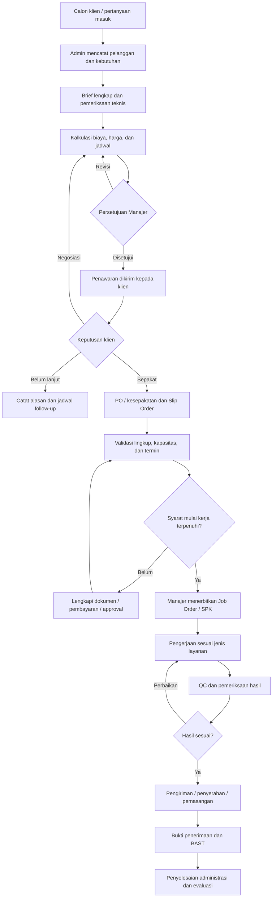
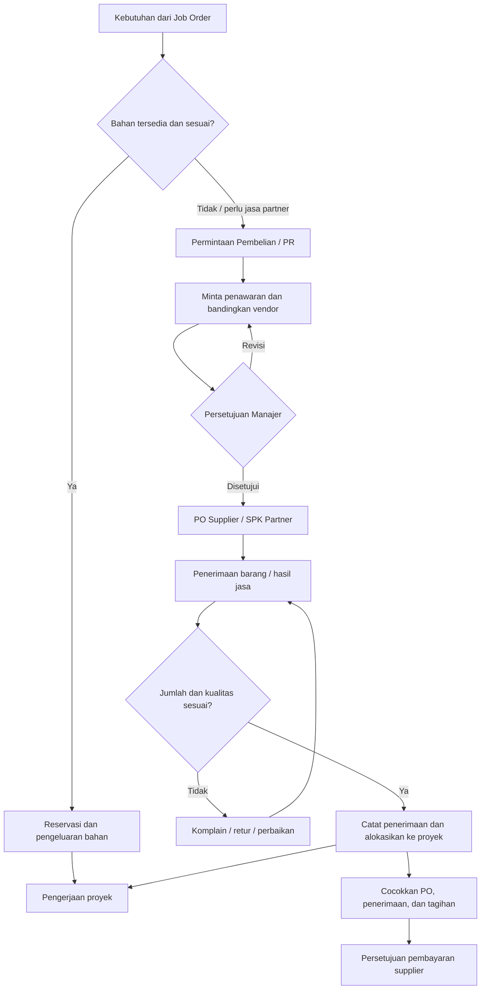
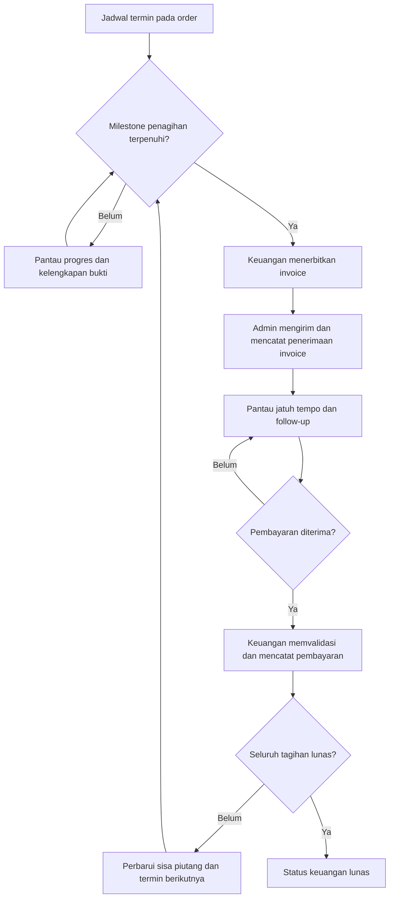

Alur ERP Utero Indonesia dibuat dengan **satu nomor proyek sebagai penghubung seluruh administrasi**, mulai dari calon klien sampai pekerjaan selesai dan pembayaran diterima.

**1. Alur utama: penjualan sampai penyerahan pekerjaan**

**Syarat mulai kerja** mengikuti kesepakatan: misalnya uang muka diterima, PO tersedia, atau fasilitas termin sudah disetujui. Sistem memberi status **“Siap Dikerjakan”** setelah persyaratan tersebut lengkap.

**2. Setelah Job Order, pekerjaan masuk ke jalur yang sesuai**

| Jenis pekerjaan | Urutan proses | Dokumen hasil |
|---|---|---|
| **Branding dan desain** | Creative brief → konsep → review internal → presentasi → revisi → persetujuan klien → finalisasi | Persetujuan desain, file final, bukti penyerahan |
| **Produksi fisik** | Spesifikasi dan desain disetujui → cek bahan → pengadaan jika diperlukan → produksi → QC → pengiriman/pemasangan | SPK produksi, pemakaian bahan, QC, Surat Jalan, BAST |
| **Video dan audio** | Brief → treatment/storyboard → persetujuan → produksi → editing → revisi → finalisasi | Persetujuan konsep, hasil final, bukti penyerahan |
| **Media advertising** | Konfirmasi media/titik/periode → pemesanan → persetujuan materi → pemasangan/penayangan → dokumentasi | Media Order, jadwal tayang, bukti pelaksanaan |
| **Event dan aktivasi** | Lingkup → kebutuhan vendor → rundown → persiapan → pelaksanaan → evaluasi | SPK partner, checklist, dokumentasi, laporan |
| **Website dan teknologi** | Kebutuhan → lingkup fitur → pengembangan → pengujian → persetujuan → penyerahan | Hasil pengujian, BAST, penyerahan akses |

Satu proyek dapat memakai beberapa jalur sekaligus. Contohnya, proyek pembukaan outlet memiliki pekerjaan **desain, signage, video, dan aktivasi**, masing-masing dengan Job Order yang terhubung ke proyek induk.

**3. Alur pembelian bahan dan penggunaan partner**

Sistem membebankan pembelian dan pemakaian bahan kepada **nomor proyek terkait**. Bahan yang sudah dibeli belum otomatis dianggap telah digunakan; pemakaiannya tetap dicatat.

**4. Alur invoice dan pembayaran**

Penagihan berjalan sesuai milestone yang disepakati. Invoice dapat diterbitkan sebelum pekerjaan dimulai, saat progres, atau setelah penyerahan.

**Status pekerjaan dan status pembayaran dipisahkan.** Proyek bisa sudah diserahkan tetapi masih memiliki piutang, atau sudah dibayar penuh tetapi masih dalam pengerjaan.

**5. Pembagian tanggung jawab dalam sistem**

| Bagian | Tanggung jawab |
|---|---|
| **Admin Penjualan / Operasional** | Data pelanggan, brief, penawaran, Slip Order, follow-up, kelengkapan dokumen, dan komunikasi status |
| **Manajer Operasional** | Persetujuan harga, jadwal, pembagian kerja, pembelian, perubahan lingkup, dan koordinasi seluruh tim |
| **Tim Kreatif / Video / IT** | Pelaksanaan pekerjaan, versi hasil, revisi, dan penyerahan hasil sesuai penugasan |
| **Admin Pembelian** | Permintaan penawaran vendor, pembanding, PO supplier, serta koordinasi pengadaan |
| **Tim Produksi** | Produksi, pemakaian bahan, progres, dan QC |
| **Operasional Umum** | Barang, alat, pengiriman, dan dukungan pemasangan |
| **Admin Keuangan** | Invoice, pencatatan biaya, utang, piutang, serta validasi pembayaran |
| **Founder** | Keputusan strategis dan persetujuan di luar kewenangan Manajer sesuai kebijakan perusahaan |

Pada tim kecil, beberapa fungsi dapat dipegang orang yang sama. Sistem tetap mencatat **peran saat bertindak, pembuat dokumen, dan pemberi persetujuannya**.

**6. Status yang perlu tersedia di ERP**

| Objek | Status |
|---|---|
| **Prospek** | Baru → Dihubungi → Kebutuhan Terkonfirmasi → Penawaran → Negosiasi → Deal / Ditunda / Tidak Lanjut |
| **Order** | Draft → Menunggu Persetujuan → Menunggu Kelengkapan → Siap Dikerjakan → Berjalan → Diserahkan → Ditutup |
| **Job Order** | Belum Mulai → Dikerjakan → Review → Revisi → Disetujui → Selesai |
| **Pembelian** | Diajukan → Ditinjau → Disetujui → Dipesan → Diterima Sebagian / Lengkap → Ditutup |
| **Invoice** | Draft → Terbit → Terkirim → Dibayar Sebagian / Lunas → Lewat Jatuh Tempo jika masih ada saldo |

**7. Hubungan data dan dokumen**

Contoh proyek: **PRJ-2026-001 — Pembuatan Signage Outlet**

| Dokumen terkait | Contoh nomor |
|---|---|
| Penawaran | QTN-2026-001 |
| Slip Order | SO-2026-001 |
| Job Order desain | JO-2026-001 |
| SPK produksi | PROD-2026-001 |
| Permintaan pembelian | PR-2026-001 |
| PO supplier | PO-2026-001 |
| Surat Jalan | SJ-2026-001 |
| Berita acara serah terima | BAST-2026-001 |
| Invoice | INV-2026-001 |
| Bukti pembayaran | PAY-2026-001 |

Semua dokumen tersebut menyimpan referensi **PRJ-2026-001**. Saat nomor proyek dibuka, admin dapat melihat pelanggan, kesepakatan, pekerjaan, pembelian, pengiriman, biaya, tagihan, dan pembayaran dalam satu tampilan.

Proyek ditutup setelah **hasil diterima, pekerjaan partner diselesaikan, biaya direkap, serta tagihan dan kewajiban diperiksa**. Bila masih ada pembayaran tertunda, status keuangannya tetap terbuka dan dapat dipantau.