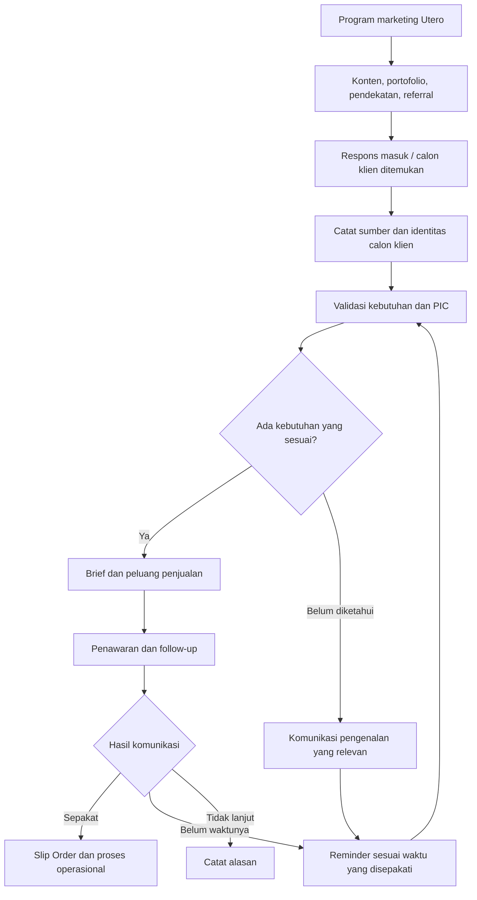
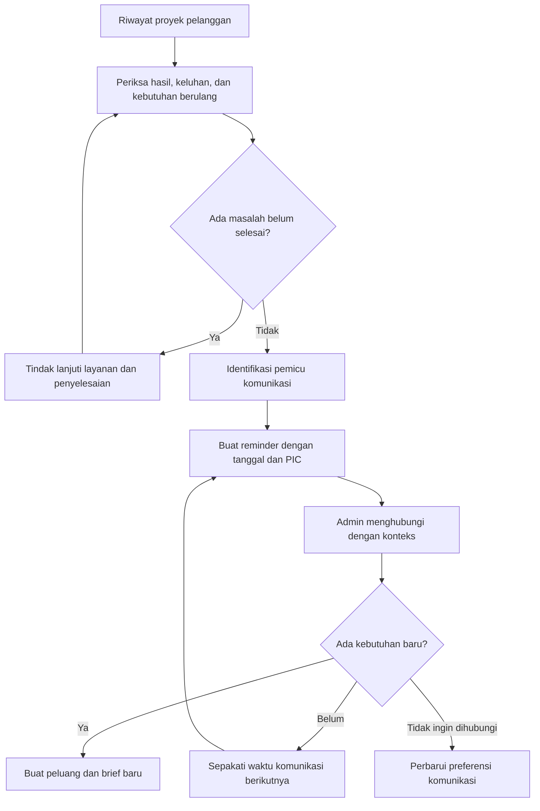

Kita tambahkan **modul Marketing, Pengembangan Klien Baru, dan Reminder Klien Lama** ke dalam ERP Utero Indonesia. Modul ini menghubungkan aktivitas promosi dengan percakapan, penawaran, order, hingga pembelian ulang.

**1. Alur marketing sampai menjadi order**

Setiap calon klien menyimpan **sumber awal**, misalnya Instagram, website, WhatsApp, referral, kunjungan, atau pendekatan admin. Dengan begitu, Utero dapat melihat program mana yang menghasilkan peluang dan transaksi.

**2. Kategori data marketing dalam ERP**

| Kategori | Data yang dicatat |
|---|---|
| **Program marketing** | Nama program, tujuan, layanan yang dipromosikan, audiens, periode, PIC, anggaran, dan hasil |
| **Database target perusahaan** | Nama perusahaan, sektor, wilayah, skala kebutuhan, kanal resmi, dan alasan menjadi target |
| **Kontak perusahaan** | Nama PIC, jabatan, kontak, kewenangan, serta kanal komunikasi yang disepakati |
| **Peluang pekerjaan** | Kebutuhan, perkiraan nilai, waktu pelaksanaan, tahap keputusan, dan langkah berikutnya |
| **Aktivitas komunikasi** | Tanggal, kanal, materi yang dikirim, respons, hasil diskusi, dan tindak lanjut |
| **Reminder** | Pemicu, tanggal pengingat, PIC Utero, tujuan komunikasi, dan status penyelesaian |
| **Riwayat pelanggan** | Proyek, spesifikasi, penawaran, transaksi, keluhan, kepuasan, serta kebutuhan berulang |
| **Peluang repeat order** | Produk/jasa yang berpotensi dipesan lagi, perkiraan waktunya, dan dasar perkiraannya |

**Satu perusahaan dapat memiliki beberapa PIC dan peluang pekerjaan.** Identitas perusahaan tetap sama agar histori komunikasi dan transaksi tidak terpecah.

**3. Program marketing untuk mendapatkan klien baru**

| Program | Sasaran dan aktivitas | Langkah lanjut |
|---|---|---|
| **Pengenalan layanan Utero** | Memperkenalkan kemampuan branding, advertising, produksi, dan teknologi melalui konten serta company profile | Minta izin mengirim portofolio yang sesuai kebutuhan |
| **Penawaran vendor perusahaan** | Menjangkau marketing, purchasing, procurement, atau pemilik usaha | Tanyakan prosedur registrasi dan kelengkapan vendor |
| **Portofolio sesuai sektor** | Kirim contoh pekerjaan yang relevan untuk F&B, ritel, hospitality, institusi, atau sektor lain | Jadwalkan percakapan kebutuhan |
| **Kebutuhan outlet dan cabang** | Menawarkan signage, branding ruang, menu, display, seragam, dan materi pembukaan | Minta lokasi, jadwal pembukaan, serta daftar kebutuhan |
| **Kampanye dan event** | Menawarkan desain, produksi materi, booth, dokumentasi, dan aktivasi | Minta kalender kegiatan serta lingkup pekerjaan |
| **Referral dan jejaring** | Meminta perkenalan dari pelanggan atau partner yang puas | Catat pemberi referensi dan hubungi pihak yang telah bersedia dikenalkan |
| **Konten edukasi** | Membahas spesifikasi, pilihan bahan, proses produksi, dan cara menyiapkan brief | Arahkan pertanyaan masuk menjadi konsultasi kebutuhan |

Pesan utama yang digunakan:

> **Utero Indonesia siap menjadi partner desain, branding, advertising, dan produksi promosi: harga kompetitif, kualitas sesuai spesifikasi, terbuka untuk kontrak vendor serta pembahasan pembayaran termin.**

Pesan tersebut disesuaikan dengan kebutuhan calon klien. Untuk perusahaan yang membutuhkan produksi berkala, admin menekankan kesiapan vendor, konsistensi spesifikasi, dan kemudahan koordinasi.

**4. Menentukan prioritas potensi klien baru**

| Prioritas | Kondisi calon klien | Tindakan admin |
|---|---|---|
| **A — Kebutuhan aktif** | Ada kebutuhan, PIC, dan waktu pelaksanaan yang jelas | Lengkapi brief, jadwalkan diskusi, siapkan penawaran |
| **B — Kebutuhan mendatang** | Ada rencana pekerjaan tetapi waktunya belum dekat | Catat perkiraan waktu dan sepakati jadwal komunikasi |
| **C — Akses awal** | Perusahaan sesuai sasaran, tetapi kebutuhan dan PIC belum diketahui | Riset kanal resmi dan minta arahan PIC |
| **D — Belum sesuai** | Kebutuhan di luar kemampuan, tidak ada kecocokan, atau menolak | Catat alasan dan hentikan pendekatan yang tidak diperlukan |

**Perkiraan potensi harus mempunyai dasar.** Contohnya: informasi pembukaan cabang, permintaan katalog, kalender event yang diberikan PIC, atau riwayat kebutuhan serupa. Nilai peluang yang belum dikonfirmasi diberi label **estimasi internal**.

**5. Alur reminder dan pengembangan klien lama**

Reminder pelanggan lama perlu menyebut **konteks pekerjaan sebelumnya**, agar percakapan terasa relevan dan membantu.

**6. Jenis reminder klien lama**

Berikut usulan pemicu awal. Waktunya dapat disesuaikan menurut jenis pekerjaan dan kesepakatan pelanggan.

| Jenis reminder | Pemicu / waktu usulan | Tujuan |
|---|---|---|
| **Pemeriksaan hasil pekerjaan** | 3–7 hari setelah penyerahan | Memastikan hasil diterima dan digunakan dengan baik |
| **Evaluasi layanan** | Sekitar 14 hari setelah penyelesaian | Mengumpulkan masukan dan menyelesaikan kendala |
| **Repeat order bahan promosi** | Berdasarkan siklus pemakaian pelanggan | Mengingatkan kebutuhan cetak atau produksi ulang |
| **Pembaruan menu dan katalog** | Menjelang perubahan produk, harga, atau periode yang diinformasikan klien | Menawarkan pembaruan materi |
| **Akhir sewa media** | 30 hari dan 14 hari sebelum periode berakhir | Membahas perpanjangan atau perubahan materi |
| **Kontrak vendor / retainer** | 60 hari dan 30 hari sebelum berakhir | Mengevaluasi kerja sama dan kebutuhan perpanjangan |
| **Kampanye musiman** | 6–8 minggu sebelum agenda yang relevan | Memberi waktu untuk konsep, persetujuan, dan produksi |
| **Pembukaan cabang** | Mengikuti rencana ekspansi yang disampaikan PIC | Menyiapkan kebutuhan branding dan promosi |
| **Perawatan signage** | Mengikuti spesifikasi dan jadwal perawatan | Menawarkan pemeriksaan kondisi atau penggantian komponen |
| **Klien tidak aktif** | Usulan 90 hari tanpa order, disesuaikan siklus pelanggan | Menanyakan perkembangan dan kebutuhan terbaru |
| **Penawaran tertunda** | Sesuai jadwal keputusan yang diberikan klien | Mengaktifkan kembali diskusi yang belum selesai |

**Reminder marketing, penagihan, dan garansi memiliki kategori berbeda**, meskipun dapat terlihat dalam satu profil pelanggan.

**7. Potensi pengembangan layanan klien lama**

| Pekerjaan sebelumnya | Potensi kebutuhan berikutnya |
|---|---|
| **Logo dan identitas brand** | Kemasan, company profile, website, signage, dan panduan penerapan |
| **Desain kemasan** | Produksi kemasan, varian baru, katalog, display, dan foto/video produk |
| **Signage outlet** | Menu, wall graphic, branding ruang, materi promo, dan kebutuhan cabang |
| **Booth pameran** | Materi event berikutnya, display produk, video, dan penyimpanan/perawatan booth |
| **Cetak materi promosi** | Cetak ulang, perubahan informasi, dan distribusi ke titik tambahan |
| **Video promosi** | Potongan konten, versi kampanye, dokumentasi, dan materi peluncuran berikutnya |
| **Website** | Pemeliharaan, pembaruan konten, landing page, dan integrasi yang diperlukan |
| **Penempatan media** | Perpanjangan periode, pergantian materi, atau penambahan titik |

Admin mengonfirmasi kebutuhan terlebih dahulu sebelum membuat penawaran tambahan.

**8. Contoh reminder yang muncul di dashboard**

| Tanggal | Pelanggan | Dasar reminder | Tindakan | Status |
|---|---|---|---|---|
| 10 November | Klien A | Signage telah diserahkan | Tanyakan kondisi hasil pemasangan | Belum dihubungi |
| 12 November | Klien B | PIC menyebut katalog diperbarui bulan depan | Konfirmasi perubahan isi dan jadwal | Terjadwal |
| 15 November | Klien C | Sewa media berakhir 30 hari lagi | Bahas perpanjangan dan materi baru | Menunggu respons |
| 18 November | Klien D | Rencana membuka cabang | Jadwalkan diskusi kebutuhan outlet | Berjalan |

*Nama dan tanggal di atas merupakan contoh penggunaan sistem.*

Setiap reminder wajib memiliki **alasan, PIC, tindakan berikutnya, dan tanggal**. Statusnya: **Terjadwal → Dihubungi → Menunggu Respons → Selesai / Dijadwalkan Ulang**.

**9. Target aktivitas admin**

| Indikator | Target awal |
|---|---:|
| Pendekatan baru ke kontak bisnis relevan | **100 per bulan** |
| Percakapan kebutuhan berkualitas | **20 per bulan** |
| Penawaran resmi | **10 per bulan** |
| Klien baru | **Target 3 per bulan** |
| Review akun klien lama | **5 akun per minggu**, menyesuaikan jumlah pelanggan |
| Pelaksanaan reminder yang jatuh tempo | **100% ditindaklanjuti atau dijadwalkan ulang dengan alasan** |
| Bahan FAQ / penawaran untuk sosmed | **Minimal 1 per minggu** |
| Pencatatan hasil komunikasi | **100% aktivitas** |

**Follow-up dan reminder tidak dihitung ulang sebagai pendekatan baru.** Klien lama yang membeli kembali dicatat sebagai repeat order, sedangkan kebutuhan layanan tambahan dicatat sebagai pengembangan akun.

**10. Contoh komunikasi kepada klien lama**

> Selamat pagi Bapak/Ibu [Nama], saya [Nama] dari Utero Indonesia. Sebelumnya kami membantu pekerjaan [nama pekerjaan]. Kami ingin memastikan hasilnya berjalan baik. Menjelang [agenda/kebutuhan yang relevan], apakah ada materi atau kebutuhan promosi yang perlu diperbarui? Kami siap membantu menyiapkan pilihan lingkup dan spesifikasinya.

Dashboard marketing akhirnya menampilkan **prospek baru, penawaran aktif, reminder hari ini, klien yang perlu ditindaklanjuti, kontrak yang mendekati akhir, serta peluang repeat order**. Setiap peluang yang disepakati langsung diteruskan ke Slip Order dan alur operasional yang sudah dibuat.